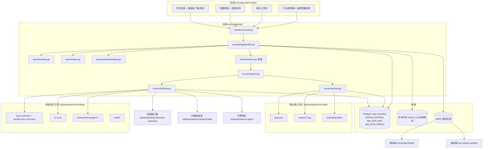

# 客户端在线打包（移动端 + 桌面端）

Feature Name: app-builder
Updated: 2026-10-20

## Description

管理员在 `/manager/app-builder` 页面完成品牌配置、素材上传、触发服务端构建、跟踪进度、下载产物、发布为更新源。平台可选移动端（Android APK）或桌面端（Linux 三件套）。

移动端：单槽 worker 执行 `gradle assembleRelease`，产物与发布清单写入既有 `/static` 静态目录，与移动端 `checkAppUpdate()` 的契约对齐。

桌面端：单槽 worker 执行 `ui-next` 构建 → 引擎 sidecar 编译 → 浏览器扩展构建 → `tauri build`，产出 deb / rpm / AppImage，其中 AppImage 按 Tauri updater 协议写出升级清单。

恢复 `migration/000028` 删除的 `app_build_jobs` 表并补齐发布链路；吸收 `mobile/ota-server/server.js` 的原生发布职责，不再需要独立 Node 进程。

桌面端交付状态：打包流水线已在本机跑通并产出三件套（见「实测基线」）；后端 Runner 抽象、产物表与路由扩展为本设计目标，尚未实现。引擎源码 `chaitin/OhMyAgent` 属私有仓库且当前不可获取，现阶段包内 sidecar 为占位二进制。

## Architecture



单槽语义由 worker 的单执行 goroutine 保证，不依赖数据库锁。HTTP 层在入队前做 `running` 检查，worker 在拾取时二次确认，两处共同构成互斥。槽位跨平台共享：桌面与移动构建串行，不同时争抢打包机内存与磁盘。

## Components and Interfaces

### 后端模块 `biz/mobilebuild/`

```
biz/mobilebuild/
  register.go                 # ProvideMobileBuild / InvokeMobileBuild
  domain/appbuilder.go        # 类型与常量
  handler/v1/build.go         # 路由注册 + 处理器
  usecase/appbuilder.go       # 业务编排
  repo/branding.go            # Ent repo（移动端品牌）
  repo/artifact.go            # Ent repo（产物条目）
  repo/desktopbranding.go     # Ent repo（桌面品牌）
  assetstore/store.go         # 素材本地文件存储
  worker/worker.go            # 单槽 worker
  runner/runner.go            # 公共层：命令执行、日志、sha256
  runner/android.go           # 移动端流水线
  runner/desktop.go           # 桌面端流水线
  runner/registry.go          # 按平台选择 runner 的工厂
```

路由组 `/api/v1/admin/app-builder`，注册在 `handler/v1/build.go`，中间件顺序 `auth.Auth()` + `auth.AdminAuth()`。管理员校验在处理器内重复一次，防止中间件链被重排。

素材落在本地文件系统而不是对象存储：素材是几 MB 的 PNG、构建机与 gradle 同机，流水线全程本地 copy 不发起网络调用；且 `pkg/oss.Client` 是各处 `NewS3Compatible` 自建、非全局 DI，依赖可选 OSS 会引入降级分支。

| 方法 | 路径 | 说明 |
|---|---|---|
| GET | `` | 能力清单（各平台 `enabled` / `missing_prereqs` / 槽位 / 步骤 / 上限），前端据此渲染 |
| GET | `/branding` | 读移动端品牌配置，缺省回落 `app.json` |
| PUT | `/branding` | 写移动端品牌配置 |
| GET | `/desktop/branding` | 读桌面品牌配置，缺省回落 `tauri.conf.json` |
| PUT | `/desktop/branding` | 写桌面品牌配置 |
| POST | `/branding/assets` | multipart `slot` + `file` |
| DELETE | `/branding/assets?slot=` | 清除槽位素材 |
| POST | `/builds` | 入队，`{platform, version, version_code}` |
| GET | `/builds` | 任务列表 |
| GET | `/builds/:id` | 任务详情含 `log_tail` 与 `artifacts[]` |
| GET | `/builds/:id/download?channel=` | 流式下载产物 |
| POST | `/builds/:id/publish?channel=` | 发布为更新源 |
| GET | `/releases` | 原生、桌面、OTA 清单当前状态 |
| POST | `/ota/publish` | OTA 发布 |
| GET | `/ota/config` | OTA 是否启用，供前端隐藏入口 |

`/builds/:id/download` 的 `channel` 缺省时按 `job.Platform` 推导唯一主产物（`android` → `apk`）；仅 `desktop-linux` 任务强制要求显式指定，否则会返回参数错误业务码。避免既有的移动端下载调用被破坏。

### `AuthMiddleware.AdminAuth()`

新增于 `middleware/auth.go`，仿照 `TeamAdminAuth`（`middleware/auth.go:49-65`）形态但谓词固定：

```go
func (m *AuthMiddleware) AdminAuth() echo.MiddlewareFunc {
    return m.Require(func(c echo.Context, u *models.User) bool {
        return u.Role == consts.UserRoleAdmin
    })
}
```

当前代码库只有 `team.AdminMemberRole` 级别的角色校验，没有平台管理员中间件，`user.Role == consts.UserRoleAdmin` 在 `biz/host/repo/publichost.go:28`、`biz/setting/repo/image.go:35` 等处已有直接判断的先例。

### 单槽 worker

仿照 `biz/task/service/tasksummary.go` 的 `Start(ctx)` / `Close()` / `sync.WaitGroup` 生命周期（`:45-48`、`:100-113`、`:116-120`）。

```
Worker.Start(ctx):
  recoverOrphans(ctx)      # running -> failed("进程中断")
  go loop(ctx)             # 唯一执行协程
loop:
  for:
    job := repo.PickOldestQueued(ctx)   # ORDER BY enqueued_at LIMIT 1
    if job == nil: sleep(pollInterval); continue
    if repo.HasRunning(ctx): sleep(pollInterval); continue   # 二次确认
    repo.Claim(ctx, job.ID, workerID)  # queued -> running
    run(ctx, job)                              # 阻塞执行
    sleep(pollInterval)
```

`PickOldestQueued` 与 `Claim` 之间用 `UPDATE ... WHERE status='queued'` 的行级条件更新做原子切换，避免极端时序下双跑。单 goroutine 意味着同一进程内不存在并发构建。

### Runner 抽象

`runner.Runner.Run` 原本只返回单个产物，无法表达桌面端的三产物。抽出产物概念并把实现按平台拆分：

```go
type Artifact struct {
    Channel  string
    FileName string
    Path     string
    SHA256   string
    Size     int64
}

type RunResult struct {
    Artifacts []Artifact
}

type BuildRunner interface {
    Platform() string
    Precheck(ctx context.Context) error
    Run(ctx context.Context, job *domain.BuildJob, onStep StepFunc, onTail TailFunc) (*RunResult, error)
}
```

包内文件划分：

- `runner.go` — 公共层：`StepFunc` / `TailFunc`、命令执行（`exec.CommandContext`）、日志文件写入、尾部截断、`ExitError`、sha256 流式计算
- `android.go` — 既有四步流程，返回单元素 `Artifacts`，`Channel = "apk"`
- `desktop.go` — 新增桌面流程
- `registry.go` — 按 `job.Platform` 返回对应 runner 的工厂

worker 侧改动最小：`execute` 里把 `runner.NewRunner(...)` 换成 `runner.ForPlatform(platform, cfg, assets, logger)`，其余状态机、断点回写、孤儿恢复全部不动。

`os/exec` 是本代码库首次引入子进程调用（当前 948 个 Go 文件零 `exec.Command`）。约束：

- `cmd.Env` 显式注入平台所需的环境变量，不依赖调用环境继承。移动端注入 `ANDROID_HOME`、`JAVA_HOME`、`PATH`；桌面端注入 `PATH`（含 `~/.cargo/bin`）与 `HOME`。Rust 经 rustup 安装后 `cargo` 不在默认 `PATH`，与 Android 显式注入 `JAVA_HOME/bin` 同理。
- `cmd.Dir` 按步骤指定。`gradlew` 位于 `mobile/android/`，不是 `mobile/`，路径错会表现为 `exit=127`。
- `CombinedOutput` 走文件（`log_dir/<jobID>.log`），避免管道缓冲导致构建期间无输出。实测 `tauri build` 的输出经 `tail` 管道后约 25 分钟无中间输出，全部结束时才刷出。
- 超时用 `context.WithTimeout`，但**超时杀进程树而非单个进程**：`exec.Command` 的 `Context` 只杀直接子进程，`npm ci` / `cargo` 会留下孙进程占用磁盘与句柄。实现上用 `SysProcAttr.Setpgid = true` 建进程组，超时后 `syscall.Kill(-pid, SIGKILL)`。
- `log_tail` 每 5 秒从日志文件尾部读 `cfg.LogTailBytes` 字节回写数据库，进度查询直接读库，无需额外缓存层。

### 移动端流水线 `runner/android.go`

步骤序列固定，每步独立记录：

| 顺序 | 步骤名 | 动作 |
|---|---|---|
| 1 | `inject-assets` | 把 `asset_root` 中的素材落到 `workspace/assets/{logo-light,logo-dark,icon,icon-dark,adaptive-icon,splash,splash-dark}.png`；空槽位不覆盖 |
| 2 | `rewrite-config` | 改 `app.json`：`expo.name`、`expo.version`、`expo.android.versionCode`、`expo.extra.baseUrl`、`expo.extra.updatesServer`、`expo.updates.enabled`、`expo.updates.url` |
| 3 | `prebuild` | `npx expo prebuild -p android`（增量，仅重写受影响的 manifest 与资源） |
| 4 | `assemble` | `cd workspace/android && ./gradlew assembleRelease --no-daemon` |
| 5 | `verify` | APK 存在、mtime 晚于任务开始、计算 sha256 与字节数 |

### 桌面端流水线 `runner/desktop.go`

已确认的硬约束（实测得到，非推断）：

| 约束 | 依据 |
| --- | --- |
| 打包必须在 Linux 主机上跑，且需要 Rust + Node 22 + Go 三套工具链 | `desktop/Makefile:check-linux`、README 前置说明 |
| 系统依赖：`libwebkit2gtk-4.1-dev`、`libgtk-3-dev`、`libayatana-appindicator3-dev`、`librsvg2-dev`、`libxdo-dev`、`xdg-utils`、`patchelf`、`gstreamer1.0-plugins-base/-good`、`rpm` | `.github/workflows/desktop-linux.yml` 与 `check-linux` |
| `bundle.active == true` 的配置必须声明 `externalBin` 且含 `binaries/ohmyagent` | `desktop/scripts/check_bundle_configs.py` |
| 打包配置只能叫 `bundle.<平台>.conf.json`，不能叫 `tauri.<平台>.conf.json` | 同上：后者被 Tauri 自动合并，会把 sidecar 要求拖进每次 `cargo check` |
| 引擎版本符号必须是全限定路径 `github.com/chaitin/ohmyagent/internal/buildinfo.Version` | `Makefile:AGENT_VERSION_SYM` 注释：包内不存在 `main.Version`，链接器对不存在的符号静默忽略 |
| 只有 AppImage 形态支持自更新 | `Makefile:linux` 注释与 `main.rs::updater_supported` |
| 冷启动 `cargo build --release` 约 28 分 36 秒，`target/` 约 1.6 GiB | 本机实测（见「实测基线」） |
| AppImage `bundleMediaFramework=true` 需要 `gstreamer1.0-plugins-base/-good` 与 `patchelf`，否则桌宠页 WebProcess 崩溃 | `Makefile:check-linux` 注释 |

五个步骤，每步有独立步骤名与退出码：

| 步骤 | 命令 | 说明 |
| --- | --- | --- |
| `ui-next` | `cd <workspace>/ui-next && npm ci && npm run build` | 产出 `uidist/` |
| `engine` | `cd <engine-src> && CGO_ENABLED=0 GOOS=linux GOARCH=amd64 go build -trimpath -ldflags "-s -w -X github.com/chaitin/ohmyagent/internal/buildinfo.Version=<hash>" -o <workspace>/binaries/ohmyagent-x86_64-unknown-linux-gnu ./cmd/ohmyagent` | 引擎 sidecar |
| `browser-extension` | `cd <extension-dir> && npm ci && npm run build` | 产出扩展 `dist/` |
| `shell` | `cd <workspace> && cargo build --release` | 冷启动约 28 分钟，此后增量 |
| `bundle` | `cd <workspace> && npx --yes @tauri-apps/cli@^2 build --config bundle.linux.conf.json` | 产出三个安装包 |

**不要走 `make linux`**：`make linux` 依赖 `engine-linux`，后者依赖 `check-ohmy-src` 校验 `agent/cmd/ohmyagent`，引擎源码缺失时必然失败。runner 直接编排上述命令，把每个子项目作为独立构建输入。

`beforeBuildCommand` 处理：`tauri.conf.json` 的 `beforeBuildCommand` 会在 `bundle` 步骤内再跑一次 `ui-next` 构建。为避免同一构建被执行两次、并让 `shell` 步骤名真实反映 cargo 编译，runner 在 `<workspace>/.appbuild/` 下生成一个覆盖配置 `bundle.appbuild.conf.json`，内容在 `bundle.linux.conf.json` 基础上把 `build.beforeBuildCommand` 置为 `{"script": ""}`，`bundle` 步骤改用该配置。该文件名以 `bundle.` 开头，符合命名不变量；`beforeBuildCommand` 不在 `check_bundle_configs.py` 的校验范围内。

`Precheck` 的具体项，任一失败即拒绝入队：

1. `desktop_workspace` 存在且含 `tauri.conf.json`、`ui-next/`、`src/main.rs`
2. `engine_src` 存在且含 `cmd/ohmyagent/main.go`
3. `extension_dir` 存在且含 `package.json`；`skills_dir` 存在（`bundle.resources` 引用，缺失会让技能列表恒空）
4. `node` / `cargo` / `go` 三个命令在 `PATH` 内
5. `binaries/` 目录可写
6. 可用磁盘 ≥ `min_free_disk_bytes`，可用内存 ≥ `min_free_mem_bytes`

超时按步骤分段：`shell` 与 `bundle` 用 `cargo_timeout`（默认 60 分钟，`tauri build` 内部会重编 Rust），其余步骤用既有 `gradle_timeout`（改名为 `build_timeout`，默认 20 分钟）。

`verify` 步校验 `target/release/bundle/deb/*.deb`、`rpm/*.rpm`、`appimage/*.AppImage` 三个文件均存在且非空，缺一即判失败并标注缺失渠道。

### 发布

移动端 `PublishNativeRelease`：

```
1. 校验 job.status == succeeded 且主产物存在
2. 读 staticDir/app-version/android.json 现有 version
3. if target <= current: 拒绝（版本过旧）
4. 复制 artifact -> staticDir/mobile/<version>/authyide.apk
5. 写 staticDir/app-version/.android.json.tmp，fsync 后 rename 覆盖 android.json
6. 步骤 5 失败则删除步骤 4 的产物，不留半成品
7. 回写 job.published_at / published_sha256
```

产物 URL 取 `<updatesBaseURL或serverBaseURL>/static/mobile/<version>/authyide.apk`，静态目录由 `static_files.dir` 提供（`config.go:235-239`，容器内 `/app/static`，挂载自 `${INSTALL_DIR}/static`，`backend/docker-compose.yml:170`），路由前缀 `/static`（`biz/static/handler/static.go:13-21`）。该前缀完全公开，产物无鉴权访问，与既有 `authyide.apk` 的行为一致。

桌面端 `PublishDesktopRelease`：AppImage 走 Tauri updater 协议，清单写在 `<静态根>/desktop/latest-linux.json`：

```json
{
  "version": "26083003.0.0",
  "notes": "",
  "pub_date": "2026-10-20T07:00:00Z",
  "url": "http://38.39.30.160:80/static/desktop/26083003/AuthyIDE_26083003.0.0_amd64.AppImage",
  "signature": ""
}
```

`updater_signing_key_path` 为空时清单仍写出，但 `signature` 留空。客户端的 `tauri-plugin-updater` 在校验签名失败时拒绝更新，因此未配置签名密钥的实例不具备自更新能力，清单只作为版本记录与下载入口。这是本设计的已知限制，写进发布响应：`ReleasesResp.Desktop.Unsigned = true`，前端据此提示需配置签名密钥。

`deb` 与 `rpm` 渠道的发布请求一律拒绝（业务码「渠道不可发布」），说明该渠道由包管理器负责升级，与壳侧 `updater_supported` 的行为一致。

清单写入沿用原子写模式：`CreateTemp` → `Write` → `Sync` → `Close` → `Chmod 0644` → `Rename`。产物复制失败或清单写入失败时回滚已复制的版本化产物。

版本号写入 `tauri.conf.json` 时补足为语义版本 `<version>.0.0`（如 `26083003` → `26083003.0.0`），供 Tauri updater 按 semver 比较；任务记录与清单仍存原始版本号，保持与移动端 `^\d{6,8}$` 校验一致。

### 前端页面

`src/pages/console/manager/app-builder.tsx`，注册点四个：

1. 页面文件，default export `TeamManagerAppBuilder`
2. `src/App.tsx` 在 `/manager` 下加 `<Route path="app-builder" .../>`
3. `src/components/manager/nav-teams.tsx` 加 `SidebarMenuItem`，用 `useAppRuntime().auth.user.role === "admin"` 控制可见
4. `src/pages/console/manager/page.tsx:28-74` 的 `breadcrumbSegmentsMap` 加条目

桌面端扩展：

1. 构建表单加平台选择器；选中 `desktop-linux` 时隐藏 versionCode 输入、隐藏 OTA 相关控件；平台不可用时禁用构建按钮并在按钮下方列出 `missing_prereqs`。
2. 任务列表行增加平台徽标；桌面任务展开时按渠道分行，每行显示渠道名、字节数、耗时、下载按钮。
3. 发布按钮仅对 `channel = "appimage"` 的行出现；`ReleasesResp.Desktop.Unsigned = true` 时在发布入口旁标注「未签名，客户端不会自动更新」。
4. 桌面品牌作为独立表单区块，与移动端品牌并列，不共享字段。
5. i18n 叶子键同步增删到 `en.ts` 与 `cn.ts`，由 `test/i18n-resources-completeness.test.ts` 强制一致。

API 层新增方法注入在 `src/api/Api.ts:2523` / `:8186` 已有的注入区块内，标记同样的 "swagger regeneration drops them" 注释。multipart 上传沿用 `apiRequest(..., { file })` 第六参形态（`src/utils/requestUtils.ts:15-67`），素材上传仿 `nav-balance.tsx:229-275` 的头像上传流程。

轮询：任务运行中 3 秒轮询 `GET /builds/:id`，空闲时 30 秒轮询 `GET /builds`，用 `window.setInterval` + cleanup，沿用 `data-provider.tsx:468-478` 的模式。进度用 `CircularProgress`（`src/components/ui/circular-progress.tsx:14-65`），步骤名直接显示。

i18n 新增顶层键 `managerAppBuilder`，结构与 `managerLicense`（`en.ts:3468-3510`）一致：`description`、`fields`、`assets`、`build`、`states`、`actions`、`releases`、`toast`。导航标签放 `managerShell.nav.appBuilder`。`test/i18n-resources-completeness.test.ts` 要求 cn/en 叶子键集合完全一致，新增测试 `test/manager-app-builder-i18n.test.ts` 仿 `test/manager-license-i18n.test.ts`。

## Data Models

### 迁移 `migration/000031_create_app_builder.sql`

```sql
CREATE TABLE app_branding (
    id uuid PRIMARY KEY DEFAULT gen_random_uuid() NOT NULL,
    name text NOT NULL,
    version text NOT NULL,
    version_code integer NOT NULL,
    server_url text NOT NULL,
    updates_server text NOT NULL DEFAULT '',
    logo_light_key text NOT NULL DEFAULT '',
    logo_dark_key text NOT NULL DEFAULT '',
    icon_key text NOT NULL DEFAULT '',
    icon_dark_key text NOT NULL DEFAULT '',
    adaptive_icon_key text NOT NULL DEFAULT '',
    splash_key text NOT NULL DEFAULT '',
    splash_dark_key text NOT NULL DEFAULT '',
    created_at timestamptz DEFAULT now() NOT NULL,
    updated_at timestamptz DEFAULT now() NOT NULL
);

CREATE UNIQUE INDEX IF NOT EXISTS idx_app_branding_single
    ON app_branding (1) WHERE (deleted_at IS NULL);

CREATE TABLE app_build_jobs (
    id uuid PRIMARY KEY DEFAULT gen_random_uuid() NOT NULL,
    user_id uuid NOT NULL REFERENCES users(id),
    platform character varying(32) NOT NULL,
    target_version text NOT NULL,
    version_code integer NOT NULL,
    status character varying(32) DEFAULT 'queued' NOT NULL,
    current_step character varying(64),
    worker_id character varying(128),
    log_path text,
    log_tail text,
    error text,
    exit_code integer,
    artifact_path text,
    artifact_sha256 text,
    artifact_size bigint DEFAULT 0 NOT NULL,
    duration_ms bigint DEFAULT 0 NOT NULL,
    published_at timestamptz,
    enqueued_at timestamptz DEFAULT now() NOT NULL,
    started_at timestamptz,
    finished_at timestamptz,
    created_at timestamptz DEFAULT now() NOT NULL,
    updated_at timestamptz DEFAULT now() NOT NULL
);

CREATE INDEX IF NOT EXISTS idx_app_build_jobs_status_enqueued_at
    ON app_build_jobs USING btree (status, enqueued_at);
CREATE INDEX IF NOT EXISTS idx_app_build_jobs_user_id
    ON app_build_jobs USING btree (user_id);
CREATE INDEX IF NOT EXISTS idx_app_build_jobs_created_at
    ON app_build_jobs USING btree (created_at DESC);
CREATE INDEX IF NOT EXISTS idx_app_build_jobs_platform
    ON app_build_jobs USING btree (platform);
```

表结构沿用 `000026:52-75` 的字段集，去掉对 `apps(id)` 的外键（本实例无用户中心 App 概念，改为按 `user_id` 记录发起者），新增 `target_version`、`version_code`、`current_step`、`log_path`、`exit_code`、`artifact_sha256`、`duration_ms`、`published_at`。

`migration/000032_add_app_build_jobs_deleted_at.sql` 补 `deleted_at` 列：ent 的 `entx.SoftDeleteMixin2` 只贡献该列且不给索引，而 ent 会给该表所有查询追加 `AND deleted_at IS NULL`，000031 漏建该列导致 worker 轮询每 2 秒报 `pq: column app_build_jobs.deleted_at does not exist`。000032 用 `ADD COLUMN IF NOT EXISTS`，对已补齐 000031 的新装实例是 no-op。

### 迁移 `migration/000033_create_app_build_artifacts.sql`

沿用 `app_build_jobs` 表达任务，新增产物表承载多产物：

```sql
CREATE TABLE app_build_artifacts (
    id              uuid PRIMARY KEY DEFAULT gen_random_uuid() NOT NULL,
    job_id          uuid NOT NULL REFERENCES app_build_jobs(id),
    platform        character varying(32) NOT NULL,
    channel         character varying(32) NOT NULL,
    file_name       text NOT NULL,
    artifact_path   text NOT NULL,
    artifact_sha256 text NOT NULL,
    artifact_size   bigint NOT NULL,
    created_at      timestamp with time zone DEFAULT now() NOT NULL,
    updated_at      timestamp with time zone DEFAULT now() NOT NULL,
    deleted_at      timestamp with time zone,
    CONSTRAINT uq_app_build_artifacts_job_channel UNIQUE (job_id, channel)
);

CREATE INDEX idx_app_build_artifacts_platform_channel
    ON app_build_artifacts USING btree (platform, channel);
```

`app_build_jobs.platform` 新增取值 `desktop-linux`；既有 `android` 的任务同步写入一条 `channel = 'apk'` 的产物记录，使下载与发布接口只有一个实现。产物列（`artifact_path` / `artifact_sha256` / `artifact_size`）保留在任务表上，指向该任务的主产物，供既有代码与日志展示使用。

`app_build_jobs.version_code` 对 `desktop-linux` 任务不适用，入队时置 0，不参与校验。

### 迁移 `migration/000034_create_desktop_branding.sql`

桌面品牌单独建表，与移动端品牌隔离：

```sql
CREATE TABLE desktop_branding (
    id                uuid PRIMARY KEY DEFAULT gen_random_uuid() NOT NULL,
    singleton_key     text NOT NULL DEFAULT 'authyide',
    product_name      text NOT NULL DEFAULT '',
    bundle_identifier text NOT NULL DEFAULT '',
    updater_endpoint  text NOT NULL DEFAULT '',
    icon_key          text NOT NULL DEFAULT '',
    created_at        timestamp with time zone DEFAULT now() NOT NULL,
    updated_at        timestamp with time zone DEFAULT now() NOT NULL,
    deleted_at        timestamp with time zone
);

CREATE UNIQUE INDEX idx_desktop_branding_single
    ON desktop_branding USING btree (singleton_key) WHERE (deleted_at IS NULL);
```

默认值从 `desktop/tauri.conf.json` 解析：`product_name = "AuthyIDE"`、`bundle_identifier = "com.authyide.app"`、`updater_endpoint` 取 `bundle.linux.conf.json` 的 `plugins.updater.endpoints[0]`。

Ent schema 新增 `ent/schema/appbranding.go`、`ent/schema/appbuildjob.go`、`ent/schema/appbuildartifact.go`、`ent/schema/desktopbranding.go`，遵循 `ent/schema/app.go:17-83` 的形态（`field.UUID("id").Default(uuid.New)`、`entx.SoftDeleteMixin2{}`、`entx.NewCursor`）。repo 层仿 `biz/app/repo/app.go`。

**改 ent schema 后必须逐列核对 hand-written SQL migration**：核对法 `psql -tAc "select column_name from information_schema.columns where table_name='<t>'"` 对 `Fields()`。

### 状态机

```
queued --claim--> running --verify ok--> succeeded --publish--> succeeded+published
    |                |
    |                +--step fail / timeout / interrupt / resource shortage--> failed
    +--(prereq missing)---------------------------------------------------------> rejected
```

状态值：`queued`、`running`、`succeeded`、`failed`。`rejected` 是入队前置检查失败的返回结果，不落库。

步骤名：移动端 `inject-assets`、`rewrite-config`、`prebuild`、`assemble`、`verify`；桌面端 `ui-next`、`engine`、`browser-extension`、`shell`、`bundle`。

## Configuration

新增 `MobileBuild` 结构体到 `config/config.go`，所有键必须同时登记 `v.SetDefault`（`config.go:425-426` 记录过未登记默认值导致 `AutomaticEnv` 静默丢弃的坑）。

| 键 | 默认值 | 环境变量 | 说明 |
|---|---|---|---|
| `mobile_build.enabled` | `false` | `MCAI_MOBILE_BUILD_ENABLED` | 移动端开关 |
| `mobile_build.workspace` | `/opt/authyide/src/mobile` | `MCAI_MOBILE_BUILD_WORKSPACE` | 移动端工作区 |
| `mobile_build.android_sdk` | `/opt/android-sdk` | `MCAI_MOBILE_BUILD_ANDROID_SDK` | |
| `mobile_build.java_home` | `/usr/lib/jvm/java-17-openjdk-amd64` | `MCAI_MOBILE_BUILD_JAVA_HOME` | |
| `mobile_build.build_timeout` | `20m` | `MCAI_MOBILE_BUILD_BUILD_TIMEOUT` | 短步骤超时（原名 `gradle_timeout`，桌面端复用） |
| `mobile_build.cargo_timeout` | `60m` | `MCAI_MOBILE_BUILD_CARGO_TIMEOUT` | 桌面端 `shell` 与 `bundle` 步骤超时 |
| `mobile_build.poll_interval` | `2s` | `MCAI_MOBILE_BUILD_POLL_INTERVAL` | |
| `mobile_build.log_tail_refresh` | `5s` | `MCAI_MOBILE_BUILD_LOG_TAIL_REFRESH` | |
| `mobile_build.log_tail_bytes` | `8192` | `MCAI_MOBILE_BUILD_LOG_TAIL_BYTES` | |
| `mobile_build.log_dir` | `/opt/authyide/data/build-logs` | `MCAI_MOBILE_BUILD_LOG_DIR` | |
| `mobile_build.asset_root` | `/opt/authyide/data/mobile-assets` | `MCAI_MOBILE_BUILD_ASSET_ROOT` | |
| `mobile_build.max_asset_bytes` | `4194304` | `MCAI_MOBILE_BUILD_MAX_ASSET_BYTES` | |
| `mobile_build.ota_enabled` | `false` | `MCAI_MOBILE_BUILD_OTA_ENABLED` | |
| `mobile_build.updates_url` | `` | `MCAI_MOBILE_BUILD_UPDATES_URL` | |
| `mobile_build.desktop_enabled` | `false` | `MCAI_MOBILE_BUILD_DESKTOP_ENABLED` | 桌面端开关 |
| `mobile_build.desktop_workspace` | `/opt/authyide/src/desktop` | `MCAI_MOBILE_BUILD_DESKTOP_WORKSPACE` | 桌面端工作区 |
| `mobile_build.engine_src` | `/opt/authyide/src/agent` | `MCAI_MOBILE_BUILD_ENGINE_SRC` | 引擎源码检出目录 |
| `mobile_build.extension_dir` | `/opt/authyide/src/browser-extension` | `MCAI_MOBILE_BUILD_EXTENSION_DIR` | |
| `mobile_build.skills_dir` | `/opt/authyide/src/plugins/skills` | `MCAI_MOBILE_BUILD_SKILLS_DIR` | |
| `mobile_build.min_free_disk_bytes` | `4294967296` | `MCAI_MOBILE_BUILD_MIN_FREE_DISK_BYTES` | 磁盘阈值 4 GiB |
| `mobile_build.min_free_mem_bytes` | `3221225472` | `MCAI_MOBILE_BUILD_MIN_FREE_MEM_BYTES` | 内存阈值 3 GiB |
| `mobile_build.updater_signing_key_path` | `""` | `MCAI_MOBILE_BUILD_UPDATER_SIGNING_KEY_PATH` | 空表示产物不签名 |

`static_dir` 不单独配置，直接复用 `static_files.dir`（`config.go:235-239`），避免两处静态根不一致。

各平台 `enabled: false` 时该平台能力清单返回不可用、入队拒绝，worker 不接该平台的任务，前端隐藏该平台入口。两个平台都关闭时模块不注册路由、不启动 worker。

Compose 侧挂载：移动端 `/opt/authyide/src/mobile:rw`、`/opt/android-sdk:ro`、`/opt/authyide/data/gradle:/root/.gradle:rw`；桌面端新增 `/opt/authyide/src/desktop:rw`、`/opt/authyide/src/agent:ro`、`/opt/authyide/src/browser-extension:rw`、`/opt/authyide/src/plugins/skills:ro`、`/opt/authyide/data/cargo`（cargo 增量缓存持久化，把重复构建从 28 分钟降到分钟级）。gradle 与 cargo 缓存均不烘焙进镜像。

**静态目录必须可写**：既有 `/opt/authyide/data/static:/app/static:ro` 要改为 `:rw`，发布时后端要把产物与清单写进 `/app/static`，`:ro` 会让发布静默失败。

## 实测基线

以下数据为 2026-10-20 在本机（`/dev/root` 20 GiB）以 `desktop/` 现仓库实测得到，作为容量规划与阈值的依据。

产物（`target/release/bundle/`，版本号 `26083003.0.0`）：

| 渠道 | 文件 | 字节数 | sha256 |
| --- | --- | --- | --- |
| `deb` | `AuthyIDE_26083003.0.0_amd64.deb` | 32,812,100 | `76ab8dcf14d152feb188fc040c69366e2e608c273d298171bff1ffaae248e4a8` |
| `rpm` | `AuthyIDE-26083003.0.0-1.x86_64.rpm` | 32,855,013 | `3c485d4b2b5830fe21a5b7df9be14f44eb1f989c3f790ee87e9df7d96bb045bb` |
| `appimage` | `AuthyIDE_26083003.0.0_amd64.AppImage` | 139,401,720 | `7e31035f7c7e327a9a90329b669848acc36494882d92978f147903cc884229f4` |

`dpkg-deb --info` 与 `rpm -qip` 元数据均有效，包名 `authy-ide`，`Depends: libayatana-appindicator3-1, libwebkit2gtk-4.1-0, libgtk-3-0`，`Installed-Size: 47879`。

包内布局：

| 路径 | 说明 |
| --- | --- |
| `usr/bin/monkeycode-desktop` | 壳二进制，44,812,456 B（`tauri build` 带 `-C strip=symbols -C lto` 重编；裸 `cargo build --release` 产物为 45,751,080 B，未 strip） |
| `usr/bin/ohmyagent` | 引擎 sidecar，1,495,224 B。与壳同目录，`find_ohmyagent()` 按可执行文件同目录查找 |
| `usr/share/applications/AuthyIDE.desktop` | 227 B |
| `usr/share/icons/hicolor/{32x32,128x128,256x256@2,512x512}/apps/monkeycode-desktop.png` | 4 档图标，1,878 / 8,776 / 17,214 / 35,897 B |
| `usr/lib/AuthyIDE/skills/` | 474 个文件，技能库 |
| `usr/lib/AuthyIDE/browser-extension/` | `manifest.json`、`background.js`、`assets/`、`src/*.html`、`icons/` |

`uidist` 经 `tauri/custom-protocol` 编进壳二进制，包内不含 `index.html`。gstreamer 只进 AppImage：AppDir 内含 116 个 `libgst*` 库与 `libwebkit2gtk-4.1.so.0`（92,517,937 B）、`libjavascriptcoregtk-4.1.so.0`（32,865,625 B）；deb 与 rpm 不含任何 gstreamer 库。

耗时与资源：

| 项 | 数值 |
| --- | --- |
| 裸 `cargo build --release`（冷） | 约 28 分 36 秒 |
| `tauri build` 内部重编（`--features tauri/custom-protocol -C strip=symbols`） | 约 13 分 19 秒 |
| `tauri build` 总墙钟（含 bundling） | 约 25 分钟 |
| 峰值内存 | 3.0-3.2 GiB |
| `target/` 体积 | 约 1.6 GiB |
| 构建期间可用磁盘最低值 | 242 MiB（构建前 1.2 GiB） |
| 构建暂存峰值 | 约 500 MiB：AppDir 335 MiB + `appimage_deb/` 48 MiB + `deb/<name>/data/` 111 MiB + `rpm/` 32 MiB |

`min_free_disk_bytes` 默认 4 GiB 的依据：AppImage 目标下 `bundleMediaFramework=true` 会把整套 gstreamer 与 webkit 拷入 AppDir，暂存约 500 MiB 且不可压缩回收；加上 `target/` 增量与 cargo 缓存写入，4 GiB 是安全下限。**磁盘低于 300 MiB 时 AppImage 阶段必然 ENOSPC**，这是实测的下限。

本机已装齐的前置（版本）：Rust 1.99.1（rustup，`$HOME/.cargo/env`）、Node v22.22.0、Go 1.25.6、`libwebkit2gtk-4.1-dev` 2.50.6、`libgtk-3-dev`、`libayatana-appindicator3-dev`、`librsvg2-dev`、`libxdo-dev`、`libssl-dev`、`gstreamer1.0-plugins-base/-good`、`xdg-utils`（`xdg-open`）、`patchelf` 0.14.3、`rpm` 4.18.0。

未装但 CI 有：`gstreamer1.0-libav`、`gstreamer1.0-alsa`。实测缺这两个 AppImage 仍能成功产出 116 个 gstreamer 库，属软性差异。

**引擎源码当前不可得**：`.gitmodules` 指向私库 `git@github.com:chaitin/OhMyAgent.git`，但本 workspace 的 git 索引只有 `README.md`、没有 gitlink，`git submodule update` 报 `pathspec 'agent' did not match`；SSH 无 host key、HTTPS clone 报 `Repository not found`、credential helper token 也无权限。CI 靠 `secrets.OHMYAGENT_REPO_TOKEN` + `insteadOf`。现阶段包内 `ohmyagent` 为占位二进制，运行即 `exit=2` 并打印「本包内的 ohmyagent 是占位二进制」。拿到源码放进 `agent/` 后重跑同一命令即得可用包。

## Correctness Properties

1. **单槽不变量**：任意时刻 `count(status='running') <= 1`，跨平台成立。由单执行协程 + 条件更新共同保证。
2. **版本单调**：`app-version/android.json` 与 `desktop/latest-linux.json` 的版本号永不递减。发布前比较，写入用原子 rename。
3. **包名稳定**：流水线不改 `expo.android.package`（恒为 `com.authyide.app`）与桌面 `bundle.identifier`，保证覆盖安装不冲突。
4. **versionCode 单调**：`version_code` 大于已发布过的最大值，否则拒绝；`desktop-linux` 任务不适用该校验。
5. **产物一致性**：已发布产物的 sha256 等于产物条目与任务记录里的 `artifact_sha256`。
6. **空素材回落**：槽位为空时使用工作区内置默认图，构建不因缺素材失败。
7. **孤儿收敛**：服务启动后 5 秒内，所有残留 `running` 任务进入 `failed`。
8. **素材白名单**：`slot` 只接受常量值之一，不参与路径拼接。
9. **版本格式**：`version` 必须匹配 `^\d{6,8}$`，与移动端 `APP_VERSION_RE`（`useOtaUpdate.ts:66`）一致；写 `tauri.conf.json` 时补足为语义版本。
10. **清单契约**：移动清单恰好是 `{"version": string, "url": string}`，`url` 为 http(s) 绝对地址；桌面清单符合 Tauri updater 协议字段集。
11. **产物渠道完整**：`desktop-linux` 成功任务的产物集合恰为 `{deb, rpm, appimage}`，`uq_app_build_artifacts_job_channel` 保证同任务同渠道唯一。
12. **可发布渠道收敛**：仅 `appimage` 渠道可发布，其余渠道一律返回渠道不可发布业务码。

## Error Handling

业务码占用 11410–11429（`errcode/errcode.go` 中 apps 已用 11400–11408）：

| 码 | 常量 | 场景 |
|---|---|---|
| 11410 | `ErrBrandingInvalid` | 品牌配置字段校验失败 |
| 11411 | `ErrAssetInvalid` | 非 PNG 或超大小 |
| 11412 | `ErrAssetSlotInvalid` | slot 不在白名单 |
| 11413 | `ErrBuildBusy` | 已有任务运行，HTTP 409 |
| 11414 | `ErrBuildNotFound` | 任务不存在 |
| 11415 | `ErrBuildArtifactMissing` | 产物不可下载 |
| 11416 | `ErrReleaseVersionTooOld` | 目标版本不高于现有清单 |
| 11417 | `ErrBuildNotSucceeded` | 对非成功任务发起发布 |
| 11418 | `ErrOtaDisabled` | OTA 未启用 |
| 11419 | `ErrWorkspaceInvalid` | 构建入口或工具链不可用 |
| 11420 | `ErrPlatformDisabled` | 平台未启用或前置检查缺失 |
| 11421 | `ErrPlatformInvalid` | platform 值不在白名单 |
| 11422 | `ErrChannelInvalid` | channel 值不在白名单 |
| 11423 | `ErrChannelNotPublishable` | 渠道不可发布（`deb` / `rpm`） |
| 11424 | `ErrResourceInsufficient` | 打包机磁盘或内存低于阈值 |

沿用 `errcode.go` 的约定：业务错误返回 HTTP 200 + 五位业务码；仅 `ErrBuildBusy` 例外返回 409，因为前端要据此区分「按钮禁用」与「静默失败」。未登录返回既有 `ErrUnauthorized`，非管理员返回 `ErrForbidden`。

失败任务的 `log_path` 始终指向完整日志文件，`log_tail` 只是视图。

## Test Strategy

后端（stdlib `testing` + `httptest`，无 testify）：

- `handler/v1/build_test.go`：仿 `biz/team/handler/http/v1/mcp_route_test.go:24-56` 断言路由字符串注册；仿 `:58-142` 用 miniredis + session 断言 admin gate（非 admin 403、未登录 401）。
- `runner/android_test.go`：用假的 `gradlew` 脚本（shell 脚本写日志并返回指定退出码）验证步骤推进、退出码记录、超时 kill、`log_tail` 截断、`ANDROID_HOME` / `JAVA_HOME` 注入、`cd` 到 `android/` 子目录。不依赖真实 gradle。
- `runner/desktop_test.go`：假 `npm` / `go` / `cargo` / `npx` 脚本（按 `$0` 与参数写日志、返回指定退出码、在 `target/release/bundle/{deb,rpm,appimage}/` 写出桩产物）验证五步推进、三产物收集、`externalBin` 命名、`ldflags -X` 参数含全限定符号、进程组超时杀（断言孙进程一并消失）、部分产物缺失判失败。不依赖真实工具链。
- `runner/registry_test.go`：断言 `ForPlatform` 对 `android` / `desktop-linux` 返回正确实现，对未知平台返回错误。
- `worker/worker_test.go`：验证单槽（连续入队两个任务，断言第一个 finished 前第二个仍 queued；跨平台同样成立）、孤儿恢复、条件更新防双跑。
- `usecase/appbuilder.go` 测试：版本比较、素材白名单、发布回滚（模拟 manifest 写入失败后断言产物已删除）、桌面发布仅接受 `appimage` 渠道、产物表与任务表主产物一致性。
- `repo/artifact_test.go`：断言 `uq_app_build_artifacts_job_channel` 唯一约束生效。
- `migration/migration_test.go`：已有 lint 要求软删列为 `deleted_at`。

前端（`node:test` + `node:assert/strict`，纯静态分析）：

- `test/manager-app-builder-i18n.test.ts`：仿 `test/manager-license-i18n.test.ts`，断言 `useTranslation`、关键 `t("managerAppBuilder.*")` 调用、无 CJK 泄漏进 en。
- `test/i18n-resources-completeness.test.ts`：自动覆盖 cn/en 键集合一致性。
- 桌面端：断言平台选择器存在、`desktop-linux` 选中时 versionCode 输入与 OTA 控件不渲染、`channel !== "appimage"` 的行不渲染发布按钮。

校验命令：

```bash
cd /workspace/backend && go build ./... && go test ./biz/mobilebuild/... ./config/... ./middleware/...
cd /workspace/frontend && pnpm exec tsc -b && node --test test/manager-app-builder-i18n.test.ts test/i18n-resources-completeness.test.ts
```

集成验证在服务器上：上传素材 → 触发构建 → 轮询状态 → 下载产物 → 发布 → 校验清单内容 → 对比移动端 `checkAppUpdate()` 与桌面端 `tauri-plugin-updater` 判定。桌面端额外校验包内 `usr/bin/ohmyagent` 的 sha256 与引擎源码构建产物一致，以此区分占位 sidecar 与真实引擎。

## Risks and Open Questions

1. **引擎源码不可得是硬阻塞**。`chaitin/OhMyAgent` 为私有仓库，本机三种获取方式全部失败。当前交付的包内 sidecar 为占位程序，运行即 `exit=2`。拿到源码填入 `agent/` 并重跑流水线才能交付可用包。
2. **未签名产物不可自更新**。`updater_signing_key_path` 为空时清单 `signature` 留空，`tauri-plugin-updater` 校验失败即拒绝更新。这是 Tauri 的机制约束，本设计把状态暴露为 `ReleasesResp.Desktop.Unsigned` 而不是隐藏。
3. **磁盘是桌面打包的第一约束**。20 GiB 磁盘上，AppImage 目标下 `bundleMediaFramework=true` 的暂存约 500 MiB 且不可压缩回收；`target/` 约 1.6 GiB 必须保留以复用增量编译，清了要重编 28 分钟。**每次构建后必须清理 `AuthyIDE.AppDir`、`appimage_deb/`、`deb/<name>/data/`、`rpm/` 才能再构建**，否则第二次直接 ENOSPC。清理动作应由 runner 在任务结束时执行，属本次交付范围。
4. **expo-updates 要求 HTTPS**（`mobile/ota-server/README.md:22`）。当前部署只有 `http://38.39.30.160`，且 app.json 已开 `usesCleartextTraffic` 供 demo。原生更新通道走 `fetch` 不受此限，风险集中在 OTA；本次 OTA 默认关闭，仅在 `ota_enabled: true` 且配了 `updates_url` 时开放。
5. **OTA 首次必须整包**（README:57）。线上现有包收不到 OTA，第一个含 expo-updates 配置的包必须通过原生发布通道分发。
6. **签名证书**：移动端沿用子项目现有 release 签名（`android/app/build.gradle` 复用 `signingConfigs.debug`）。跨实例复用时签名不同会导致覆盖安装失败，属已知限制。
7. **`expo prebuild` 幂等性**：prebuild 会重置 `gradle.properties`，需要在流水线里 prebuild 之后重新校准该文件。
8. **`tauri build` 重编 Rust**。它跑的是 `cargo build --bins --features tauri/custom-protocol --release`，feature 组合与裸 `cargo build --release` 不同，先跑 `cargo build` 并不能省掉 bundling 前的重编时间。`shell` 步骤的价值在于让编译阶段有独立步骤名与日志，而非省时间。
9. **构建资源**：单槽下 gradle 峰值约 4 GiB、cargo 峰值约 3.2 GiB，服务器 15.6 GiB 内存无 swap 可容纳但不可并行。禁止与前端 vite 构建并发，本次不做互斥检测，仅文档约束。
