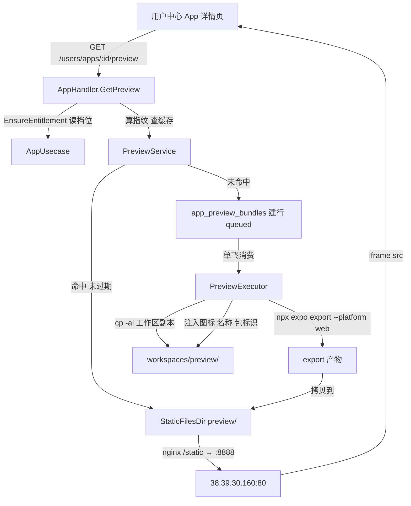
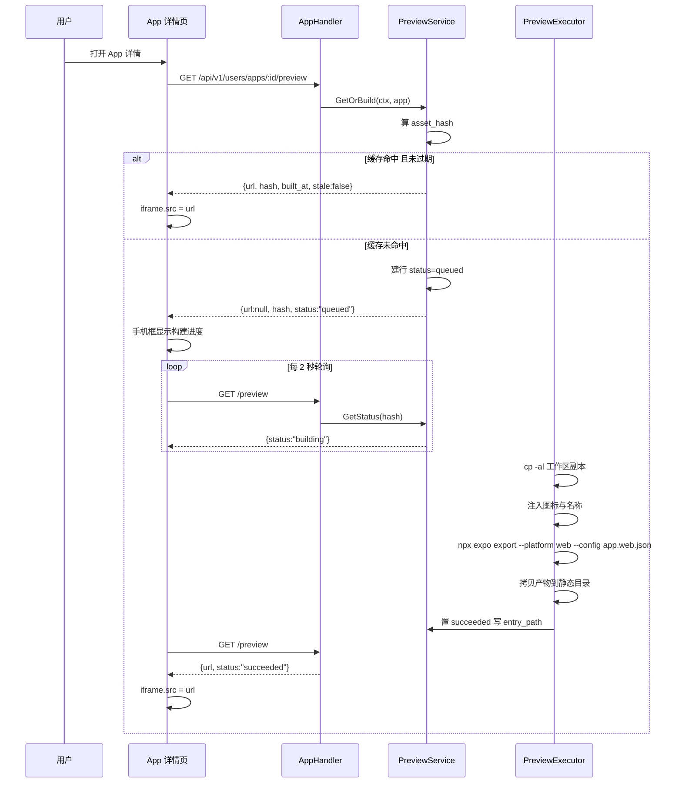

# APP 实时预览（App Live Preview）技术设计

Feature Name: app-live-preview
Updated: 2026-10-20
Status: draft

## Description

在用户中心内嵌 iframe，渲染 App 的 Web 版本。预览构建是按需触发的一次性
静态导出：`npx expo export --platform web --config app.web.json`，
产物落到 `cfg.MobileBuild.StaticFilesDir` 下由后端既有 `/static` 路由对外服务，
不新增 nginx 规则。

## Why static export instead of a persistent Metro server

用户选的是 Expo Web iframe 内嵌。iframe 里放什么有两种做法，取舍如下：

| 维度 | 静态导出（本设计） | Metro 常驻开发服务器 |
| --- | --- | --- |
| 常驻进程 | 无 | 每个 App 一个 Metro 进程，端口需申请与回收 |
| 前端形态 | 纯静态，直接嵌 iframe | 需要端口转发链路或反代 |
| 热更新 | 无，改配置触发重建 | 有，Metro 推送 |
| 构建机约束 | 与打包 worker 天然隔离 | 必须为长驻进程设计内存与磁盘回收 |
| 部署环境 | 服务器 15.6G RAM 无 swap，进程数即风险 | 多用户并发时 Metro 进程数放大 |
| 预览延迟 | 缓存命中 0ms，重建 40-90 秒 | 首屏 5-15 秒，之后毫秒级 |
| 产物一致性 | 与真实构建同一条导出路径 | 开发态代码，与产物可能有差异 |

选择静态导出的理由是产物一致性：预览出来的东西和打包出来的东西走同一条
Metro 导出链路，用户在预览里看到的品牌效果不会到真机突然不一样。
代价是没有热更新，改一次配置等 40-90 秒。这个代价在验收标准里写成了
Requirement 1 的「构建中显示进度」而不是「改完即时刷新」。

## Architecture





## Components and Interfaces

### 预览服务

`backend/biz/mobilebuild/preview/service.go`

```go
type Service interface {
    // GetOrBuild returns an existing bundle for the app's asset hash, or
    // creates a queued preview task when the hash is missing or expired.
    GetOrBuild(ctx context.Context, app *db.App, branding *db.AppBranding) (*PreviewRef, error)
    // Status returns the current build state for one hash without triggering work.
    Status(ctx context.Context, appID uuid.UUID, hash string) (*PreviewRef, error)
}

type PreviewRef struct {
    AppID   uuid.UUID
    Hash    string
    Status  string // queued | building | succeeded | failed
    URL     string
    BuiltAt time.Time
    Step    string
    Error   string
    Native  []string // 不可用能力清单
    Stale   bool
}
```

服务注册在 `biz/mobilebuild/register.go`，新增 `do.Provide(i, preview.NewService)`，
在 `biz/app/register.go` 的 `InvokeMobileBuild` 同层 `do.MustInvoke` 拉起
`PreviewExecutor`。

### 单飞执行器

`backend/biz/mobilebuild/preview/executor.go`

独立于打包 worker 的另一个单协程，两个队列互不阻塞：

```go
func (e *Executor) run(ctx context.Context) {
    for {
        row, err := e.repo.ClaimNext(ctx) // WHERE status IN ('queued') ORDER BY created_at LIMIT 1
        if err != nil {
            e.log.Warn("claim preview failed", "error", err)
            e.sleep(ctx, 2*time.Second)
            continue
        }
        if row == nil {
            e.sleep(ctx, 2*time.Second)
            continue
        }
        e.repo.SetBuilding(ctx, row.ID)
        if err := e.build(ctx, row); err != nil {
            e.repo.SetFailed(ctx, row.ID, err.Error())
        }
    }
}
```

与打包 worker 的关系：

- 打包 worker 消费 `app_build_jobs`，预览执行器消费 `app_preview_bundles`，
  两条队列完全独立，预览排队不堵打包。
- 两个执行器都各自单协程串行，所以同一台构建机上最多两个子进程在跑
  （一个 `gradlew`，一个 `npx expo export`）。
- 磁盘是共享风险：预览导出临时目录在任务结束时必须清理，
  与打包工作区副本同样处理，否则本机 20G 磁盘会在两次构建后耗尽。

### 构建步骤

`build(ctx, row)` 的六步，对应前端可见的 `current_step`：

1. `preparing` — `cp -al` 建工作区副本到 `<asset_root>/workspaces/preview/<taskID>`，
   设置 `GRADLE_USER_HOME` 与 `npm_config_cache` 为副本内路径，避免写穿源目录。
2. `injecting` — 从 `assetstore` 读该 App 的图标键对应字节，写入副本的
   `assets/icon.png`；无图标键时回落实例品牌素材，再回落工程内置素材。
3. `configuring` — 改写副本 `app.json` 的 `expo.name` 与 `expo.slug`。
4. `exporting` — 在副本内执行 `npx expo export --platform web --config app.web.json`，
   进程组隔离与超时控制沿用打包 runner 的实现：
   `SysProcAttr.Setpgid = true` 加 `syscall.Kill(-pid, SIGKILL)`，超时 5 分钟。
   `exec.Command` 的 `Context` 只杀直接子进程，Metro 会留孙进程占句柄，必须杀进程组。
5. `publishing` — 将 `dist/` 拷到 `<static_files.dir>/preview/<app_id>/<hash>/`，
   同时写 `manifest.json` 记录指纹、构建时间、不可用能力清单。
6. `done` — 置 `succeeded`，删工作区副本。

任一步失败清理工作区副本，静态目录只写成功产物。

### 资源指纹

```go
func AssetHash(app *db.App, b *db.AppBranding) string {
    h := sha256.New()
    fmt.Fprintf(h, "name=%s\n", app.Name)
    fmt.Fprintf(h, "package_id=%s\n", app.PackageID)
    fmt.Fprintf(h, "icon_key=%s\n", app.IconKey)
    fmt.Fprintf(h, "brand_version=%s\n", b.Version)
    fmt.Fprintf(h, "brand_assets=%s|%s|%s|%s|%s|%s|%s\n",
        b.LogoLightKey, b.LogoDarkKey, b.IconKey, b.IconDarkKey,
        b.AdaptiveIconKey, b.SplashKey, b.SplashDarkKey)
    fmt.Fprintf(h, "mobile_tree=%s\n", MobileTreeHash) // 见下
    return hex.EncodeToString(h.Sum(nil))
}
```

`MobileTreeHash` 是 `mobile/src` 与 `mobile/app.json` 与
`mobile/package.json` 的目录哈希，构建启动时算一次并缓存。
指纹含源码树的目的：改了 App 代码，旧预览包不该继续冒充当前效果。

### Web 专用配置

新增 `mobile/app.web.json`，仅覆盖输出模式：

```json
{
  "expo": {
    "web": {
      "output": "static",
      "name": "AuthyIDE",
      "bundler": "metro",
      "outputPath": "./dist"
    }
  }
}
```

主 `app.json` 的 `web.output` 保持 `single` 不动。该值面向原生容器内嵌，
改为 `static` 会影响原生打包链路；`expo export --config app.web.json`
是深度合并语义，覆盖后的产物只影响预览。

`outputPath` 指向副本根下的 `./dist`，与打包链路的 `android/` 输出目录
并列，不冲突。

### 前端 iframe 与手机框

新增 `frontend/src/components/console/app/app-preview-frame.tsx`。

结构：外层一个 390:844 比例的容器，内部 `<iframe>`，`sandbox="allow-same-origin allow-scripts"`。
手机框用 `aspect-ratio: 390/844` 与 `max-height` 约束，宽度自适应，
缩放比例用 `transform: scale()` 实现，不改变 iframe 内部视口。

轮询策略：`useEffect` 内 `setInterval(2000)`，命中 `succeeded` 后清除定时器。
组件卸载时清除定时器与 iframe src，避免切换 App 时残留上一次的品牌。

页面挂载位置：新增 `frontend/src/pages/console/user/app-detail.tsx`，
路由 `/user/apps/:id`。`console/user/apps.tsx` 保留列表职责，
`Page.tsx` 的 `breadcrumbSegmentsMap` 补一条把 `:id` 解析为该 App 名称。

### 能力层

移动端新增 `mobile/src/platform/capabilities.ts`，集中声明每个原生模块的
Web 可用性：

```ts
export const WEB_CAPABILITIES: Record<string, boolean> = {
  "expo-secure-store": false,
  "expo-camera": false,
  "expo-av": false,
  "expo-blur": false,
  "expo-haptics": false,
  "react-native-gesture-handler": true,
  "@react-native-community/netinfo": true,
  "expo-linking": true,
  "expo-clipboard": true,
};
```

构建期扫描 `package.json` 的实际依赖与这份清单求交集，差集写进
`manifest.json` 的 `native_unavailable`。页面侧用
`useUnavailableCapabilities()` 读取该清单，渲染不可用能力的调用点时
输出占位块。

占位块不是静默降级：占位文字必须包含能力名与「仅在原生平台可用」的说明，
用户能看出这里少了一块功能，而不是以为功能坏了。

### 鉴权与同源

预览产物放在 `cfg.MobileBuild.StaticFilesDir` 下，走后端既有 `/static` 路由。
nginx `/static/` 代理到 `127.0.0.1:8888` 已存在，零新增规则。

iframe 内的 App 请求后端 API 时，走同源 `/api/v1/users/apps/...`，
`credentials: "same-origin"` 由前端 `Api.ts:2584` 已统一配置。
预览 iframe 与宿主页面同源，用户 cookie 自动带上，无需额外 token 注入。

产物本身放在 `<app_id>/<hash>/` 两级目录下，路径含 App 主键。
主键是 UUID，未启用时序可枚举性；但为防遍历，后端在 `/static` 路由上
对 `/static/preview/` 前缀追加一次归属校验：解析 `:app_id` 与当前用户比对，
不匹配返回 404。这是唯一需要动后端静态路由的地方。

## Data Models

### 迁移 000036：预览包表

```sql
CREATE TABLE IF NOT EXISTS app_preview_bundles (
    id uuid PRIMARY KEY DEFAULT gen_random_uuid() NOT NULL,
    app_id uuid NOT NULL REFERENCES apps(id) ON DELETE CASCADE,
    user_id uuid NOT NULL REFERENCES users(id),
    asset_hash text NOT NULL,
    entry_path text NOT NULL DEFAULT '',
    status character varying(32) NOT NULL DEFAULT 'queued',
    current_step character varying(64) NOT NULL DEFAULT '',
    worker_id character varying(128) NOT NULL DEFAULT '',
    duration_ms bigint NOT NULL DEFAULT 0,
    error text NOT NULL DEFAULT '',
    native_unavailable jsonb NOT NULL DEFAULT '[]'::jsonb,
    enqueued_at timestamp with time zone NOT NULL DEFAULT now(),
    started_at timestamp with time zone,
    finished_at timestamp with time zone,
    created_at timestamp with time zone NOT NULL DEFAULT now(),
    updated_at timestamp with time zone NOT NULL DEFAULT now(),
    deleted_at timestamp with time zone
);

CREATE UNIQUE INDEX IF NOT EXISTS idx_app_preview_bundles_app_hash
    ON app_preview_bundles USING btree (app_id, asset_hash);
CREATE INDEX IF NOT EXISTS idx_app_preview_bundles_status
    ON app_preview_bundles USING btree (status, enqueued_at);
CREATE INDEX IF NOT EXISTS idx_app_preview_bundles_user_id
    ON app_preview_bundles USING btree (user_id);
```

`ON DELETE CASCADE` 让删除 App 时自动清行；静态文件目录由删除流程显式清理，
数据库外键管不到文件系统。

ent schema 新增 `backend/ent/schema/apppreviewbundle.go`。
改完必须逐列核对 hand-written SQL：`entx.SoftDeleteMixin2` 只贡献
`deleted_at` 一列（无索引），与 000031 的 `app_branding` 同一模式。

`app_build_jobs` 不动，预览不占用打包计数器。

### 配置项

复用 `config.AppBuilderConfig`，新增两项：

- `Preview.TTLHours int`，默认 `24`，env `MCAI_APPBUILDER_PREVIEW_TTL_HOURS`
- `Preview.TimeoutSeconds int`，默认 `300`，env `MCAI_APPBUILDER_PREVIEW_TIMEOUT_SECONDS`

`config.go:477-478` 已注明未注册 `SetDefault` 的 key 在 `Unmarshal` 时被静默忽略，
两个新 key 必须在装配处补 `SetDefault`。

## Correctness Properties

1. 每个 `app_id` 加 `asset_hash` 组合唯一，不会出现两个同指纹的预览包。
2. 同一时刻处于 `building` 状态的预览包数不超过 1。
3. `status` 为 `succeeded` 的预览包，其 `entry_path` 指向的目录必须存在。
4. `status` 为 `failed` 的预览包，其 `entry_path` 为空字符串。
5. `duration_ms` 只在 `status` 进入终态时写入，中间态保持 0。
6. `native_unavailable` 的元素集合是 `package.json` 依赖与 `WEB_CAPABILITIES`
   中值为 `false` 的项的交集。
7. 删除 App 后，`app_preview_bundles` 中该 App 的行数为 0。
8. 预览构建不改变 `apps.build_count` 与 `entitlements.free_builds_used`。
9. `asset_hash` 的计算输入包含移动端源码树哈希，源码变更后旧指纹必然失效。
10. 预览产物的静态路径必须包含 `app_id`，跨 App 不可共享目录。
11. `PreviewExecutor` 与打包 `worker` 不共享队列，互不阻塞。
12. 单个预览构建的墙钟耗时不超过 `Preview.TimeoutSeconds`。

## Error Handling

| 场景 | 处理 |
| --- | --- |
| 工作区副本创建失败 | 任务置 `failed`，错误含 `cp -al` 输出，`ErrPreviewBuildFailed` 11428 |
| 图标对象读取失败 | 任务置 `failed`，错误含对象键，`ErrPreviewBuildFailed` 11428 |
| `expo export` 非零退出 | 任务置 `failed`，`log_tail` 取 stdout 尾部 8KB，`ErrPreviewBuildFailed` 11428 |
| `expo export` 超时 | 杀进程组，任务置 `failed`，错误含 `timeout`，`ErrPreviewBuildFailed` 11428 |
| 缺少 Web 依赖 | 任务置 `failed`，错误列出缺失依赖名，`ErrPreviewBuildFailed` 11428 |
| 产物写入静态目录失败 | 任务置 `failed`，`entry_path` 保持空，`ErrPreviewBuildFailed` 11428 |
| 导出目录残留 | 每次任务结束（成功或失败）清理 `workspaces/preview/<taskID>` |
| 磁盘不足 | 任务置 `failed`，错误含 `ENOSPC`，前端提示构建机磁盘不足 |
| 同一 App 并发请求预览 | 单飞合并，返回首个任务的 `status`，不建第二个任务 |
| App 已删除 | `GET /preview` 返回 `ErrAppNotFound` 11400 |
| 用户访问他人预览路径 | `/static/preview/<app_id>/...` 返回 404，不泄露存在性 |
| iframe 内运行时错误 | 手机框内显示错误信息，外层配置面板保持 |

业务码分配：

| 码 | 常量 | 说明 |
| --- | --- | --- |
| 11427 | `ErrPreviewBuilding` | 预览构建中，HTTP 409 |
| 11428 | `ErrPreviewBuildFailed` | 预览构建失败或依赖缺失，HTTP 200 |

11420-11424 已被 `app-builder` 规格的桌面部分预留，
11425-11426 已被 `app-self-service-packaging` 使用，本特性从 11427 起取号。

## Test Strategy

单元测试（`backend/biz/mobilebuild/preview/`）：

1. `AssetHash` 对图标键变更、名称变更、品牌版本变更分别产生不同哈希。
2. `AssetHash` 在源码树哈希不变时保持稳定，跨进程可复现。
3. `GetOrBuild` 缓存命中且未过期时不建行。
4. `GetOrBuild` 缓存命中但超过 `TTLHours` 时建新行。
5. `GetOrBuild` 指纹未命中时建 `queued` 行。
6. `GetOrBuild` 同 App 已有 `queued` 或 `building` 行时返回该行，不建第二个。
7. `ClaimNext` 在多条 `queued` 时按 `enqueued_at` 升序取一条。
8. `ClaimNext` 加 `FOR UPDATE SKIP LOCKED` 语义，两个执行器实例不同时认领同一行。
9. 单飞执行器在 `build` 返回错误时置 `failed` 并清理工作区副本。
10. 超时路径杀的是进程组，`/proc` 下无残留孙进程。

前端测试：

11. 手机框在 `queued` 与 `building` 状态显示进度，`succeeded` 后加载 iframe。
12. 手机框在 `failed` 状态显示错误与重试入口，不自动重试。
13. 组件卸载清除轮询定时器，不产生卸载后 setState。
14. `test/i18n-resources-completeness.test.ts` 通过（en/cn 叶子键一致）。
15. `tsc -b` 通过，`npm run build:offline` 产出成功。

集成验证（部署到测试实例）：

16. 迁移 000036 up 后 down，表结构与列顺序复原。
17. 改 ent schema 后逐列核对 `information_schema.columns`。
18. 首次预览冷启动耗时记录在案，作为后续回归基线。
19. 缓存命中路径耗时小于 100ms。
20. 预览 iframe 内点击后端 API，请求带正确用户 cookie，响应非 401。
21. 用户 A 直接访问用户 B 的预览静态路径，返回 404。
22. 删除 App 后，数据库行与静态目录均清空。
23. 预览构建期间提交打包任务，打包不被阻塞；打包运行中请求预览，预览不被阻塞。
24. 连续两次预览构建后构建机磁盘剩余空间不低于基线减 500MB。

## References

- `mobile/app.json` — `web.output` 当前为 `single`，需 Web 专用配置覆盖
- `mobile/package.json` — 已声明 `react-native-web ~0.21.0`、`react-dom 19.2.0`、`expo ^55.0.27`
- `frontend/src/components/console/task/task-preview-panel.tsx` — 既有 VM 端口预览范式，可复用空态与刷新按钮写法
- `frontend/src/pages/console/user/app-detail.tsx` — 本特性新增页面，路由 `/user/apps/:id`
- `frontend/src/components/manager/nav-teams.tsx`、`App.tsx`、`Page.tsx` — 新增页面需同步的三处接线
- `frontend/test/i18n-resources-completeness.test.ts` — en/cn 叶子键一致性守卫
- `backend/biz/mobilebuild/worker/worker.go:37` — 打包 worker 的单协程范式，预览执行器沿用
- `backend/biz/mobilebuild/runner/runner.go` — 进程组隔离与超时实现，预览执行器复用
- `backend/migration/000031_create_app_builder.up.sql` — `app_branding` 单例索引模式，预览包表沿用
- `.monkeycode/specs/app-self-service-packaging/design.md` — 业务码 11425/11426 已占用
- `.monkeycode/specs/app-builder/design.md` — 业务码 11420-11424 已预留
