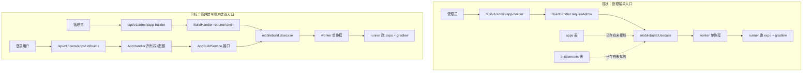
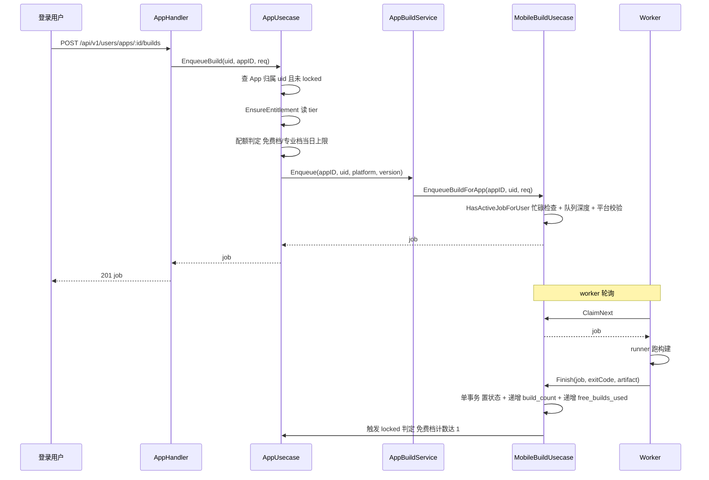

# 自助打包（App Self-Service Packaging）技术设计

Feature Name: app-self-service-packaging
Updated: 2026-10-20
Status: draft

## Description

把现有管理端打包链路开放给所有登录用户，按 `entitlements.tier` 限制构建次数。
构建流水线、worker、runner、资产存储、发布链路全部沿用 `biz/mobilebuild`
现有实现，本设计只做四件事：任务表补 `app_id` 关联、配额判定接入、路由前缀
迁移到用户前缀、前端在用户中心暴露入口。

## Architecture

### 现状与目标



### 调用链



## Components and Interfaces

### 迁移 000035：任务表补 app_id

```sql
ALTER TABLE app_build_jobs ADD COLUMN app_id uuid REFERENCES apps(id);
CREATE INDEX IF NOT EXISTS idx_app_build_jobs_app_id_status
    ON app_build_jobs USING btree (app_id, status);
CREATE INDEX IF NOT EXISTS idx_app_build_jobs_user_id_enqueued_at
    ON app_build_jobs USING btree (user_id, enqueued_at DESC);
```

`app_id` 可空：管理端任务不关联 App。down 迁移删列与两个索引。

ent schema 变更（`backend/ent/schema/appbuildjob.go`）：

```go
field.UUID("app_id", uuid.UUID{}).Optional().Nillable(),
```

同时 `appbuildjob.go` 补 `edge.From("app", App.Type).Ref("build_jobs")`，
`app.go` 补 `edge.To("build_jobs", AppBuildJob.Type)`。改完 ent schema 后
必须逐列核对 hand-written SQL：`entx.SoftDeleteMixin2` 只贡献 `deleted_at`
一列（无索引）。

### AppBuildService 接口

定义在仓库根的 `backend/domain/appbuild.go`（`biz/app` 没有自己的 domain
包），避免 `biz/app` 直接依赖 `biz/mobilebuild` 的包符号：

```go
type AppBuildService interface {
    Enqueue(ctx context.Context, in AppBuildInput) (*AppBuildJob, error)
    Get(ctx context.Context, owner, id uuid.UUID) (*AppBuildJob, error)
    List(ctx context.Context, owner, appID uuid.UUID) ([]*AppBuildJob, error)
    Download(ctx context.Context, owner, id uuid.UUID) (AppBuildArtifact, error)
    Publish(ctx context.Context, owner, id uuid.UUID) (*AppBuildRelease, error)
    Delete(ctx context.Context, owner, id uuid.UUID) error
    CountToday(ctx context.Context, owner uuid.UUID) (int, error)
}

type AppBuildInput struct {
    AppID       uuid.UUID
    Owner       uuid.UUID
    Platform    string
    Version     string
    VersionCode int
}
```

实现在 `backend/biz/mobilebuild/usecase/appbuildservice.go`
（`NewAppBuildService(i *do.Injector) (appdomain.AppBuildService, error)`），
注册在 `backend/biz/mobilebuild/register.go`，由 `biz/app` usecase 注入。
所有方法都接收 `owner` 并在仓储层用 `user_id = owner` 做行级过滤，
跨用户请求统一返回 `ErrBuildNotFound`，不泄露任务是否存在。

### 用户端路由

挂在 `biz/app/handler/v1/app.go` 已有的 `/api/v1/users/apps` 组下：

```go
v1.POST("/:id/builds", web.BindHandler(h.EnqueueBuild))
v1.GET("/:id/builds", web.BindHandler(h.ListBuilds))
v1.GET("/builds/:jobID", web.BindHandler(h.GetBuild))
v1.GET("/builds/:jobID/download", web.BindHandler(h.DownloadBuild))
v1.POST("/builds/:jobID/publish", web.BindHandler(h.PublishBuild))
v1.DELETE("/builds/:jobID", web.BindHandler(h.DeleteBuild))
```

`:jobID` 放在 `:id` 之外，避免与 `GET /:id` 的路由冲突。鉴权沿用该组现有的
`auth.Auth()` + `targetActive.TargetActive()`，不引入 `AdminAuth`。

### 配额判定

落在 `biz/app/usecase/app.go`，因为权益表归它管。新增方法
`canBuild(ctx context.Context, uid uuid.UUID, app *db.App) error`
（`app.go:223`）：

```go
func (u *appUsecase) canBuild(ctx context.Context, uid uuid.UUID, app *db.App) error {
    ent, err := u.repo.EnsureEntitlement(ctx, uid)
    if err != nil {
        return errcode.ErrDatabaseQuery.Wrap(err)
    }
    if app.Locked {
        return errcode.ErrAppLocked
    }
    if consts.PlanTier(ent.Tier) == consts.PlanTierFree && app.BuildCount >= consts.FreeAppBuildsPerApp {
        return errcode.ErrAppBuildQuotaExceeded
    }
    if consts.PlanTier(ent.Tier) == consts.PlanTierPro {
        if limit := u.cfg.MobileBuild.DailyBuildLimit; limit > 0 {
            n, err := u.builds.CountToday(ctx, uid)
            if err != nil {
                return err
            }
            if n >= limit {
                return errcode.ErrBuildDailyQuotaExceeded
            }
        }
    }
    return nil
}
```

常量：`FreeAppBuildsPerApp = 1`。配置项挂在 `MobileBuild` 结构下
（`config.go:263-267` 的 `QueueDepth` / `DailyBuildLimit`），viper key 是
`mobile_build.queue_depth`（默认 `20`）与 `mobile_build.daily_build_limit`
（默认 `0`，不限次），对应 env `MCAI_MOBILE_BUILD_QUEUE_DEPTH`、
`MCAI_MOBILE_BUILD_DAILY_BUILD_LIMIT`（viper 用 `MCAI_` 前缀 + `.`→`_`）。
`config.go:472-473` 已注册这两个 `SetDefault`——`config.go:478-480`
注明：未注册 default 的 key 在 `Unmarshal` 时被 viper 的 `AutomaticEnv`
静默忽略，本项目无 config.yaml、全靠 env 注入，所以缺 `SetDefault` 就等于失效。

实现与本节伪码的十六处偏离：
1. 伪码里的桌面许可门禁（`consts.PlatformDesktopLinux`）未实现：代码库里没有
   桌面平台常量，平台常量只有 `biz/mobilebuild/domain/appbuilder.go:71` 的
   `PlatformAndroid = "android"`。`errcode.ErrAppDesktopUnlicensed`（11407）
   与 `entitlements.desktop_licensed` 字段都已存在，只是没有可判定的平台入口，
   本特性一律只打包 `android`。
2. 忙碌校验（`HasActiveJobForUser` → `ErrBuildBusy`）放在 `mobilebuild` 的
   `usecase.enqueueBuild` 里（`appbuilder.go:387-395`），admin 走全局
   `AnyRunning`、用户端走按用户统计的活跃任务检查；`canBuild` 只做配额判定。
3. 当日上限只约束专业档：需求 R3 AC3/4/8 三处都写「专业档」，免费档由
   每 App 一次成功构建约束，配置值 `<= 0` 时专业档不限次。
4. 忙碌与当日计数都按「用户」维度而非「用户 + App」：与 R3 AC7 的
   「该用户已有任一非终态构建任务」保持一致，也保证单 worker 下一个用户
   任意时刻只有一个排队中的任务。
5. 发布清单是全局单槽而非按 App 隔离：`PublishOwned` 最终走
   `publishJob`（`appbuilder.go:553-597`），`ReadManifest(ctx, PlatformAndroid)`
   读的是全局原生更新清单，产物落到共享静态目录
   `<static>/releases/<version>/`。同一版本被两个不同用户的 App 占用时，后者
   命中 `ErrReleaseVersionTooOld`（11416）被拒；不同版本可以先后发布，但只保留
   一个「当前版本」供移动端拉取。这与 R5 AC4「写入发布清单」字面一致，属于沿用
   管理端既有单槽语义，不为本特性引入按 App 的清单分片。
6. R5 AC5（OTA 未启用则拒绝）在用户端路由上不可达：`POST /builds/:jobID/publish`
   走的是原生发布（`PublishOwned` → `publishJob` → `android.json` 清单），
   OTA 是管理端独立路由 `POST /api/v1/admin/app-builder/ota/publish`，
   用户端没有 OTA 通道，所以 `ErrOtaDisabled`（11418）无从触发。
   R5 AC7（平台集合校验）改在入队处生效：`enqueueBuild` 的
   `platformEnabled`（`appbuilder.go:369`）已拒绝平台集合外的任务，
   因此不存在平台越界的任务可供发布，`publishJob` 不再重复校验。
7. R4 AC4 的锁定原未实现，现已补上：`apps.locked` 在 `biz/` 里只有两个
   读取点（`biz/app/usecase/app.go:120` 的编辑冻结、`:228` 的 `canBuild`），
   没有任何写入点，导致免费档 App 建成后永久保持可编辑。现在
   `CompleteForApp`（`repo/appbuildjob.go:139`）在同一事务内对免费档
   `SetLocked(true)`，与 `AddBuildCount(1)` 原子提交。
8. R4 AC3 的「失败不改计数」原被违反，现已修正：worker 的 `fail()`
   （`worker/worker.go:245`）与成功路径共用 `complete()`，而
   `CompleteForApp` 原先无条件 `AddBuildCount(1)` 与 `SetFreeBuildsUsed(+1)`，
   等于一次失败就吃掉免费档那唯一一次构建并把 App 锁死。现在
   `res.Status != BuildStatusSucceeded` 时只落任务终态就返回，计数与锁定
   完全不碰；管理端 `FinishJob` 本来就不动计数，两路现在语义一致。
9. R4 AC5 的「0 行影响时记日志并返回数据库业务码、不回滚任务状态」无法实现：
   ent 的 `UpdateOneID(...).Exec(ctx)` 不返回受影响行数，0 行不报错，事务内的
   job 状态更新与计数更新同涨同跌。实际取舍是「计数失败则整笔回滚」，
   任务留在 `queued`/`running` 而非 `succeeded`——宁可让用户看到任务没结束，
   也不出现「计数没记但任务显示成功」。
10. **R6 的品牌与素材来源未实现（本特性最大的缺口，见下文专节）**：
    `apps.icon_key` 字段全程无读写方，用户能设的图标对构建产物完全无影响。
11. R7 AC5 的「素材互相覆盖」原真实存在，现已修正：`workspaceFor`
    用 `cp -al` 给每个用户任务复制模板工作区，硬链接共享 inode，而
    runner 原先用 `os.WriteFile` 原地截断写 `app.json`、`assets/*.png`、
    `local.properties`、`gradle.properties`。截断作用于共享 inode，等于
    用户任务直接改掉模板本身；下一轮 admin 构建时 `setStr` 遇空值跳过
    （`runner.go` 的 `setStr` 对空串不赋值），模板里残留的 slug、
    `android.package`、`extra.adNetwork`、`extra.adAppID` 就进了 admin
    APK，而 admin APK 经原生发布清单面向全部用户分发。
    已新增 `atomicWriteFile`（同目录临时文件 + `os.Rename`），rename 替换
    目录项、不动 inode，四处写盘全部改走它。模板从此不被改写，
    且构建中断也不会留下半个 `app.json`。
12. admin 任务产物不持久，属已知限制：admin 沿用模板工作区（R7 AC1 要求），
    APK 落在模板内的 `android/app/build/outputs/apk/release/app-release.apk`，
    `worker.go:191` 的产物迁出只在 `isolated` 为真时执行，所以 admin 任务
    的 `artifact_path` 指向模板内部。下一次构建会覆盖或删除该文件，
    而 `appbuilder.go:514` 的下载只做 `os.Stat` 存在性校验、不校验内容，
    于是旧任务的下载链接可能返回新构建的 APK。要彻底解决需给 admin
    单独落产物目录，与 AC1「沿用现有工作区」冲突，本特性未改。
13. R1 AC3 的冲突业务码原不返回，现已修正：`(user_id, package_id)` 的
    部分唯一索引 `idx_apps_user_package_id`（`WHERE deleted_at IS NULL`，
    000026 迁移）本身存在，重复创建会失败，但 usecase 把所有错误统一包成
    `ErrDatabaseOperation`，前端拿到的是通用数据库错误而非 11402。
    `errcode.ErrAppPackageIDConflict` 定义在 `errcode.go:161` 却全库零引用。
    已加 `db.IsConstraintError` 分支映射到 11402。`apps` 表除该唯一索引外
    无其他约束，故约束错误即包标识冲突。
14. `repo.Update` 收了 `uid` 却不用：`biz/app/repo/app.go:63` 走
    `UpdateOneID(id)`，没有 `UserID(uid)` 谓词，而同文件的 `Delete`
    同时带两个条件。AC4 的所有权在 usecase 层（先 `Get(ctx, uid, id)`）
    成立，所以 API 面安全；仓储层这处是与 `Delete` 不一致的纵深缺口，
    任何将来直连 repo 的调用方会绕过归属校验。本特性未改。
15. R8 AC1/AC2/AC5/AC7 前端原只实现一半，已补齐：
    AC1 缺平台支持矩阵与素材槽位——矩阵已加（渲染 `enabled_platforms`
    徽标，此前面板把 `platform: "android"` 写死在提交体里）；素材槽位仍缺，
    与 R6 同源。AC2 只读 `app.build_count` 当「已用次数」展示，
    既没有档位也没有剩余次数；已加档位卡片与剩余次数卡片
    （免费档 `max(0, 1 - build_count)`，其余档位显示不限）。
    AC5 只刷新了构建历史——`build_count` 由父页面传入，入队后只调
    `loadJobs()`，构建完成后剩余次数不刷新；已加 `onChanged` 回调，
    用 `statusSeen` 记录每个任务的旧状态，仅在真实状态迁移到终态时
    触发父页面 `load()`。AC7 失败任务只渲染 `job.error` 一行，
    没有日志尾部也没有重试入口；已加 `log_tail` 预排版块与重试按钮
    （回填版本号并加 1，因为服务端要求 `version_code` 大于历史最大值）。
16. `onChanged` 存在一个真实的循环风险，靠 ref 规避：父页面传的是
    组件体内定义的 `load`，每次渲染都是新函数。若直接放进 `loadJobs`
    的 `useCallback` 依赖数组，`loadJobs` 身份会随父渲染变化，
    而挂载 effect 依赖 `loadJobs`，会不断重置任务列表并重新拉取。
    故面板内用 `onChangedRef` 存最新回调，`loadJobs` 依赖数组保持
    `[api, app.id]` 不变。

### 业务码分配

`backend/errcode/errcode.go:159-164` 已占用 11400-11408，
`:167-176` 已占用 11410-11419。本特性使用空闲位：

| 码 | 常量 | 说明 |
| --- | --- | --- |
| 11402 | `ErrAppPackageIDConflict` | 用户名下包标识冲突 |
| 11403 | `ErrAppBuildQuotaExceeded` | 免费档构建额度已用完 |
| 11406 | `ErrBuildDailyQuotaExceeded` | 专业档当日额度已用完 |
| 11425 | `ErrBuildQueueFull` | 队列已满 |
| 11426 | `ErrBuildFailed` | 工作区准备或素材读取失败 |

11407 的 `ErrAppDesktopUnlicensed` 已存在，直接复用。11420-11424 已被
`app-builder` 规格的桌面部分预留（见该规格 design.md），本特性从 11425 起取号。

### 工作区隔离

现状 `runner` 把品牌素材写进单一 `cfg.MobileBuild.Workspace`，
管理端和用户端共用会互相覆盖。改为按任务建硬链接副本：

```go
func (r *Runner) workspaceFor(jobID string) (string, error) {
    dst := filepath.Join(r.cfg.AssetRoot, "workspaces", jobID)
    if err := os.MkdirAll(filepath.Dir(dst), 0o755); err != nil {
        return "", err
    }
    // cp -al 建硬链接树：源文件只读共享，写入触发 inode 分裂
    cmd := exec.Command("cp", "-al", r.cfg.Workspace, dst)
    cmd.Env = r.buildEnv(dst)
    if out, err := cmd.CombinedOutput(); err != nil {
        return "", fmt.Errorf("prepare workspace: %w: %s", err, out)
    }
    return dst, nil
}
```

配套约束：

- `runner` 对源工作区只做只读操作；`expo prebuild` 的 `android/` 输出落在副本内。
- `GRADLE_USER_HOME` 按任务设为 `<asset_root>/gradle/<jobID>`，避免共享锁文件争用。
- 任务结束时按交付范围清理副本目录，不清理会在第二次构建时耗尽磁盘（本机磁盘只有 20G）。
- 硬链接副本只省磁盘不省 `cp` 的时间，移动端工作区排除 node_modules 后约 6.7M，可接受。

### 单执行协程与排队

worker 沿用单协程串行执行，不加并发。多用户下排队等待变长，用两个手段约束：

- 入队处的 `HasActiveJobForUser` 检查（`usecase.enqueueBuild`，见上文偏离
  说明 2）使每个用户同时只有一个非终态任务。
- 仓储层 `ListByStatusIn("queued")` 按 `enqueued_at` 升序取前
  `cfg.MobileBuild.QueueDepth` 条，默认 `20`；超出深度的任务直接置为 `failed`
  并写入「队列已满」，入队方返回 `ErrBuildQueueFull`（11425）。

### 品牌与素材注入（未实现，需后续补齐）

R6 的 User Story 是「我构建产物携带自己的品牌，所以我分发的应用带我的标识」。
目前只有身份类字段生效，视觉素材完全没接上。

**已生效**：`worker.runnerConfig`（`worker/worker.go:259`）把 App 的
`name`、`package_id`、`ad_network`、`ad_app_id` 写入 `runner.Config`，
`runner.rewriteConfig` 落进 `app.json` 的 `expo.name`/`expo.slug`/
`expo.android.package`/`expo.extra.adNetwork`/`expo.extra.adAppID`；
版本号与 versionCode 取自任务行的 `target_version`/`version_code`。
R6 AC2 成立：App 名称覆盖实例级 `branding.name`，缺失时用实例值。

**未生效**：`apps.icon_key` 是一个孤立字段，双向都不通。

- 无写方：前端 `src/` 全量搜索 `iconKey` 零命中，`app-editor.tsx`
  （209 行）不含图标上传或素材槽位 UI。字段虽可由
  `UpdateAppReq.IconKey`（`domain/app.go:123`）经
  `biz/app/repo/app.go:71` 写入，但用户端没有任何入口会调它。
- 无读方：`GetAppBranding`（`repo/appbuildjob.go`）查的是完整 App 行、
  字段里就有 `IconKey`，但构造 `domain.AppBranding` 时直接丢弃，
  结构体本身也没有这个字段。构建链路因此完全看不见它。

**素材来源是全局单套**：`runner.injectAssets`（`runner/runner.go:244`）
遍历固定的 `domain.AssetSlots` 七槽（`logo-light`/`logo-dark`/`icon`/
`icon-dark`/`adaptive-icon`/`splash`/`splash-dark`），从
`assetstore.Store` 按槽名读取并写进工作区 `assets/<slot>.png`。
槽名不含 App 维度，素材库也没有按 App 命名的命名空间，所以每个用户的
APK 拿到的是同一套管理员配置的品牌素材，差异只在名称、包标识、广告配置与版本号。

R6 各条对照：

| 条款 | 状态 |
| --- | --- |
| AC1 读 App 的图标键与包标识 | 包标识成立；图标键无读方 |
| AC2 实例品牌作默认值、App 版本字段覆盖 | 成立 |
| AC3 无图标键则用实例素材、再回落内置默认 | 未实现，无 App 维度选择，无回落链 |
| AC4 素材读取失败则置 failed 并写错误 | 对所读的全局槽成立：`Read` 报错即中止构建并记错误；`ErrEmpty` 跳过该槽，工作区模板内的内置文件保留 |

补齐需要的设计决策：素材库引入 App 维度命名空间（如 `apps/<appID>/<slot>`），
或在 `assetstore` 之外为 App 建对象存储 key 映射；然后
`domain.AppBranding` 补字段、`GetAppBranding` 映射、`runner.Config` 传参、
`injectAssets` 改按 App 取值并做回落。约五个文件联动，且必须带编译与部署验证，
本轮因内存不足无法本地编译、SSH 不通无法部署，故只记录不改代码。

### 用户端页面

改动集中在三处，不新建页面目录：

- `frontend/src/pages/console/user/apps.tsx`：在现有 `apps` 页的 Tabs 上加第三个
  tab `build`（「打包 APK」），选中某个 App 后渲染 `AppBuildsPanel`，用
  `key={selected.id}` 强制切 App 时重置状态。非 list tab 时渲染面包屑
  「应用列表 / {app.name}」，复用 `@/components/ui/breadcrumb`
  （需求 R8 AC9）。
- `frontend/src/components/console/apps/app-builds-panel.tsx`（新增）：
  额度卡片 + 版本号/版本代号表单 + 构建历史列表。`queued` / `running` 状态
  每 5 秒轮询 `ListBuilds`；成功行展示产物 sha256 前 12 位、完整摘要放
  tooltip（需求 R8 AC6）；下载走 `v1UsersAppsBuildsDownload` 拿 blob 后
  `URL.createObjectURL` + `<a download>`。
- `frontend/src/api/Api.ts`：按现有惯例手工注入 6 个 build 方法与
  `DomainAppBuildJob` / `DomainAppBuildRelease` 类型，`DomainListAppsResp`
  补 `tier` / `host_quota`。

i18n 在 `src/i18n/resources/{cn,en}.ts` 的 `consoleApps.tabs.build` 与
`consoleApps.builds.*` 下各约 30 个叶子键；`test/i18n-resources-completeness.test.ts`
强制 en/cn 叶子键集合完全一致，增删必须两边同步。

注意：`consoleApps.builds` 与 `managerAppBuilder.build` / `managerAppBuilder.releases`
是两套独立的文案块，前者是用户端、后者是管理端，键名重叠但语义不同，
不要合并。

## Data Models

### app_build_jobs 变更

新增列 `app_id uuid NULL REFERENCES apps(id)`。

现有列 `user_id` 语义收紧为「谁提交的」，用户端任务与 App 归属用户相同，
管理端任务归属提交该任务的管理员。

### apps 复用

| 列 | 本特性用法 |
| --- | --- |
| `build_count` | 构建成功时加一，免费档判定的依据 |
| `locked` | 免费档 `build_count` 达到 1 后置真 |
| `last_built_at` / `last_build_platform` / `last_build_artifact_key` | 构建结束时写入 |
| `icon_key` | 构建品牌输入，覆盖实例级素材 |
| `package_id` | 写入 `app.json` 的 `slug` 与 Android `applicationId` |
| `name` | 写入 `app.json` 的 `name` 与 `branding.name` |
| `enabled_platforms` | 校验请求的平台是否合法 |

### entitlements 复用

| 列 | 本特性用法 |
| --- | --- |
| `tier` | `free` / `pro`，决定走哪条配额分支 |
| `free_builds_used` | 构建成功时加一，账户级计数 |
| `desktop_licensed` | 桌面平台准入门字段；本特性未读取（只打包 `android`，见配额判定偏离说明 1） |

### 配置项

在现有 `config.MobileBuildConfig`（`config.go:69` 挂载为 `MobileBuild`）上追加
两个字段，原有 14 项 mobile build 字段保留不动：`QueueDepth int`
（`mapstructure:"queue_depth"`）与 `DailyBuildLimit int`
（`mapstructure:"daily_build_limit"`），见 `config.go:263-267`。

## Correctness Properties

1. `app_build_jobs.app_id` 引用的 App 归属用户等于该任务的 `user_id`。
2. 任一时刻处于 `running` 状态的任务数不超过 1。
3. 任一用户处于非终态（`queued` / `running`）的任务数不超过 1。
4. 免费档用户的每个 App，`build_count` 达到 1 后 `locked` 必为真。
5. 构建失败的任务不改变 `build_count` 与 `free_builds_used`。
6. `build_count` 加一与任务状态置 `succeeded` 在同一个数据库事务内完成。
7. 用户端请求返回的任务集合只含 `user_id = 请求用户` 的行。
8. 同一用户同一 App 不存在两条 `queued` 任务。
9. 管理端任务的 `app_id` 为空，用户端任务的 `app_id` 非空。
10. 构建结束时的计数更新影响行数为 0 视为异常并返回错误，不静默成功。

## Error Handling

| 场景 | 业务码 | HTTP |
| --- | --- | --- |
| App 不属于请求用户 | `ErrAppNotFound` 11400 | 200 |
| App 已锁定 | `ErrAppLocked` 11401 | 200 |
| 免费档额度用完 | `ErrAppBuildQuotaExceeded` 11403 | 200 |
| 包标识冲突 | `ErrAppPackageIDConflict` 11402 | 200 |
| 桌面未授权（本特性未触发） | `ErrAppDesktopUnlicensed` 11407 | 200 |
| 当日额度用完 | `ErrBuildDailyQuotaExceeded` 11406 | 200 |
| 有进行中任务 | `ErrBuildBusy` 11413 | 409 |
| 任务不属于请求用户 | `ErrBuildNotFound` 11414 | 200 |
| 产物缺失 | `ErrBuildArtifactMissing` 11415 | 200 |
| 任务未成功 | `ErrBuildNotSucceeded` 11417 | 200 |
| 版本过旧 | `ErrReleaseVersionTooOld` 11416 | 200 |
| 平台不在 App 平台集合 | `ErrAppInvalidPlatform` 11404 | 200 |
| 队列已满 | `ErrBuildQueueFull` 11425 | 200 |
| 工作区准备失败 | `ErrBuildFailed` 11426 | 200 |
| 素材对象读取失败 | `ErrBuildFailed` 11426 | 200 |

runner 侧的进程超时杀进程组沿用现有实现：
`SysProcAttr.Setpgid = true` 加 `syscall.Kill(-pid, SIGKILL)`。
`exec.Command` 的 `Context` 只杀直接子进程，`npm ci` 与 `cargo` 会留下
孙进程占磁盘句柄，必须杀整个进程组。

## Test Strategy

单元测试（尚未编写：`biz/app/usecase`、`biz/app/repo` 与
`biz/mobilebuild/...` 当前均无测试文件，下面的用例是落地清单）：

1. `canBuild` 四条分支：免费档已用 / 免费档未用 / 专业档超上限 / 专业档未超
   上限，外加 App 已锁定，各一用例。（桌面未授权分支未实现，见上文偏离说明）
2. `EnqueueBuildForApp` 在配额通过时写入 `app_id` 且状态为 `queued`。
3. `EnqueueBuildForApp` 在 `HasActiveJobForUser` 为真时返回 `ErrBuildBusy`
   且不写行。
4. `CompleteForApp` 成功路径在同一事务内递增 `build_count` 与
   `free_builds_used`，且免费档触发 `locked`。
5. `CompleteForApp` 失败路径不改动任何计数字段。
6. `CompleteForApp` 计数更新影响 0 行时返回错误。

仓储层测试（`backend/biz/mobilebuild/repo/appbuildjob_test.go`，同属待补）：

7. `ListByApp` 只返回归属该用户的任务。
8. `GetOwnedJob` 对他人任务返回 not found。
9. `repo.CountJobsToday(ctx, userID)` 按 24 小时窗口统计该用户所有 App 的
   任务数，跨窗口不累计；`AppBuildService.CountToday` 是其对外同名包装。
10. `HasActiveJobForUser` 只统计 `queued` 与 `running`。

集成验证：

11. 迁移 000035 在 PostgreSQL 18.6 上 up 后 down，表结构与列顺序复原。
12. 改 ent schema 后逐列核对 `information_schema.columns`。
13. 两个不同用户并发提交构建，只有一个进入 `running`，另一个保持 `queued`。
14. 免费档用户首次构建成功后 `apps.locked` 置真，同一 App 再提交返回
    `ErrAppLocked`（11401），不是 `ErrAppBuildQuotaExceeded`（11403）——
    `canBuild` 里锁定检查（`biz/app/usecase/app.go:228`）先于免费档计数检查
    （`:230`），而两者的触发边界同为 `build_count` 达到 1，R3 AC6 与 AC2 的
    条件完全重叠，实现取锁定码优先。
14a. 免费档用户构建失败后 `build_count` 与 `free_builds_used` 不变、
     App 未锁定，可以立即重试同一 App。
15. 用户 A 用 `:jobID` 路径请求用户 B 的任务，返回 `ErrBuildNotFound`，
    响应体不泄露 B 的任务信息。

线上无登录态验证（38.39.30.160，已执行）：

- 路由是否注册用 HTTP 码判定：401 表示已注册只需鉴权，404 表示未注册。
  `GET /api/v1/users/apps` 与 `GET /api/v1/users/apps/ad-networks` 均返回 401，
  管理端 `/api/v1/admin/app-builder` 保持 401，即用户端路由已上线且管理端未被破坏。
- 数据库侧：`max(version)=35`、`app_build_jobs.app_id uuid YES`、
  `idx_app_build_jobs_app_id_status`、`idx_app_build_jobs_user_id_enqueued_at`、
  FK `app_build_jobs_app_id_fk` 齐备。
- 容器侧：`authyide-backend` Up、`RestartCount=0`、全日志 `panic:` 计数 0、
  `build poll failed` 计数 0。

线上登录态冒烟（未执行）：

方法已备好但没跑成。做法是临时给 backend 注入 `MCAI_SECURITY_CAPTCHA_ENABLED=false`
关掉验证码（captcha 未关时 `password-login` 返回 403「禁止访问」，不是 401，
容易被误判成密码错），走真实登录 `POST /api/v1/users/password-login`
（body 为 `{email, password: md5(初始密码)}`），再带 cookie 逐条打 6 条路由，
验完把配置改回并重建容器。

配额拒绝分支的探测不要真入队：

- 建一个 `enabled_platforms=["ios"]` 的 App，对它 POST android 构建。
  `canBuild` 在平台门禁（11404）之前执行，返回 11404 即证明鉴权、归属、配额判定
  全跑通且没落任何 job 行。注意 `platformEnabled` 在空集时返回 true（空集=全部平台），
  不能靠空数组挡住 android。
- 要触发每日上限就给 `app_build_jobs` 插一行 `status='failed'` 的合成数据——
  worker 的 `PickOldestQueued` 只捞 `queued`，不会执行；`CountJobsToday` 按
  `user_id + enqueued_at` 24 小时窗口计数，不看状态、不看 `app_id`，所以能计入。
  验完走 `DELETE /api/v1/users/apps/builds/:jobID` 软删。
- 版本号是 6-8 位数字（`^\d{6,8}$`），不是 semver，传 `1.0.0` 会得到 11410。

归属链路的静态审计（已执行，替代未跑成的登录态冒烟）：

SSH 出口被封后无法走 HTTP 层，改为逐层静态核对归属过滤是否成立。结论是六条
用户端路由的 owner 全部由服务端从会话派生，不接受任何客户端传入的用户标识：

1. handler 层（`biz/app/handler/v1/app.go`）：六个 handler 一律
   `middleware.GetUser(c)` 取 `user.ID`，nil 时返回 `ErrUnauthorized`；请求体与
   路径参数里没有任何用户 ID 字段，跨用户越权没有注入入口。
2. usecase 层（`biz/app/usecase/app.go:180-223`）：`EnqueueBuild` 先
   `repo.Get(ctx, uid, appID)` 做归属校验（非本人返回 `ErrAppNotFound`），
   再过 `canBuild`，然后 `builds.Enqueue` 传入 `Owner: uid`；`ListBuilds`
   同样先校验 App 归属；其余四个方法把 `uid` 透传到 mobilebuild。
3. mobilebuild 层（`biz/mobilebuild/usecase/appbuilder.go`）：
   `EnqueueBuildForApp` :340、`DownloadOwned` :493、`PublishOwned` :553
   均先 `repo.GetOwnedJob(ctx, owner, id)` 再放行，nil 一律映射
   `ErrBuildNotFound`，不返回「存在但不属于你」这类可区分信息。
4. repo 层（`biz/mobilebuild/repo/appbuildjob.go`）：`GetOwnedJob`、
   `ListByApp`、`DeleteOwnedJob` 的 Where 条件都同时含 `user_id = owner`
   与目标 ID；`CountJobsToday`、`HasActiveJobForUser` 只按 owner 统计。
5. 软删除语义（`pkg/entx/softdelete2.go:39-50`）：查询被拦截器自动加
   `deleted_at IS NULL`，因此 `DELETE /builds/:jobID` 之后该行对
   `CountJobsToday`、`CountQueued`、`HasActiveJobForUser` 立即不可见，
   上面的配额探测清理不需要硬删。

审计确认了 Test Strategy 第 15 项（他人 `:jobID` 返回 `ErrBuildNotFound`、
响应体不泄露任务信息）在代码层成立，覆盖读、下载、发布、删除四条路径。
残余风险只在「登录态本身能建立」这一点：401-vs-404 的无登录态验证只能证明
路由已注册，无法证明 session 解析、配额判定与真实 worker 执行链路可用，
这部分仍待 SSH 恢复后手动跑 `/tmp/opencode/deploy-appbuilder/97-run.sh`。

计数与事务链路的静态审计（已执行，发现并修正两处缺陷）：

顺着 worker 的终态落库路径核 R4 时定位到两个问题，均已修在
`repo/appbuildjob.go` 的 `CompleteForApp` 内：

1. **失败构建吃掉配额**：`worker/worker.go:245` 的 `fail()` 与成功路径共用
   `complete()`，而 `CompleteForApp` 无条件递增 `build_count` 与
   `free_builds_used`。免费档用户唯一一次构建若失败，就被永久锁在
   `ErrAppBuildQuotaExceeded` 后面。现在 `res.Status != BuildStatusSucceeded`
   时提前返回，只落任务终态。管理端 `FinishJob`（`repo/branding.go:286`）
   本来就不碰计数，两条路径现在一致。
2. **`locked` 从未被写入**：`apps.locked` 只有 `biz/app/usecase/app.go:120`
   与 `:228` 两个读取点。已补为成功且免费档时在同一事务内 `SetLocked(true)`。

其余 R4 条款核对通过：`CompleteForApp` 全程包在 `entx.WithTx2` 单事务里，
任务状态、`build_count`、`last_built_at`、`last_build_platform`、
`last_build_artifact_key`、`free_builds_used` 六项同涨同跌。迁移 000035 的
down 文件与 up 文件逐条对应（先删 FK、再删两个索引、最后删列），FK 约束名
与线上核实的一致；ent schema 声明了同列名的两个索引但没有 FK 注解，
所以 ent 迁移器不会与 SQL 迁移产生第二个 FK。

编译验证未能完成：本机磁盘 0 字节可用、可用内存不足 1GiB，
`go build` 的构建缓存改放 `/dev/shm` 后仍被 OOM killer 终止在
`backend/db`（ent 生成的巨型包）上，属于环境 OOM 而非编译错误，
且终止点在待改文件之前。已用 gofmt 校验语法（exit 0），并逐个到生成代码里
核实了引用的标识符：`AppUpdate.SetLocked(bool)`（`db/app_update.go:191`）、
`db.Entitlement.Tier`（`db/entitlement.go:25`）、`consts.PlanTier` 与
`consts.PlanTierFree`（`consts/plan.go:4,7`）、`domain.BuildStatusSucceeded`
（`domain/appbuilder.go:16`）。

前端验证：

16. `tsc -b` 通过。
17. `node --test test/*.test.ts`：当前基线是 262 例 / 228 pass / 34 fail。
    这 34 个失败全部是 AuthyIDE 改名遗留的陈旧断言（仍断言 `MonkeyCode 智能任务`、
    `长亭科技`、`CyberServal`、`SafeLine WAF` 等，而 `src/` 已零处残留），
    与本特性无关；判定回归看这份失败清单是否变化。
18. `test/i18n-resources-completeness.test.ts` 通过（en/cn 叶子键一致）。
19. `npm run lint`（等价 `eslint .`）对本次改动的 `app-builds-panel.tsx`、
    `apps.tsx`、`api/Api.ts`、`i18n/resources/{cn,en}.ts` 零告警。
20. `./node_modules/.bin/vite build --mode online` 产出成功（约 4m24s）；
    `build:offline` 与 `build:online` 只差 `--mode`。
21. 后端 `go build -o /tmp/opencode/server ./cmd/server` 通过，作为
    DI 装配与路由注册的集成校验（`go build ./...` 在本机 15 分钟超时，
    需定向构建；迁移跑 `go test ./migration/...`）。

## References

- `backend/ent/schema/app.go` — `App` 与 `Entitlement` 现有定义
- `backend/biz/app/usecase/app.go:50,70,102,151` — 既有 `EnsureEntitlement` 调用点
- `backend/migration/000028_remove_app_build_and_ad_placements.up.sql` — 撤回该能力的历史迁移
- `backend/migration/000031_create_app_builder.up.sql` — 重建 `app_build_jobs` 的迁移
- `backend/biz/mobilebuild/handler/v1/build.go:22,410` — 现有路由前缀与 `requireAdmin`
- `backend/errcode/errcode.go:159-176` — 业务码占用情况
- `.monkeycode/specs/app-builder/requirements.md` — 打包能力与权限收敛需求
- `.monkeycode/specs/app-builder/design.md` — Runner 抽象与桌面 runner 设计
