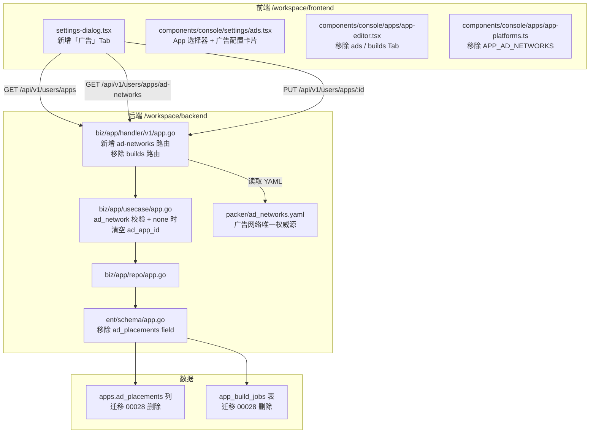

# 用户中心广告应用 ID 设计

Feature Name: user-center-ad-app-id
Updated: 2026-10-17

## Description

把广告配置从应用编辑器解耦，搬到用户中心设置对话框，并按"每个应用一个广告网络 + 一个应用 ID"建模。只做这两件事：选择广告网络、填入自己的应用 ID。平台不投放、不结算、不校验 ID。

同时移除本版本不交付的部分：广告位映射网格、Flutter 打包构建管线（worker、构建任务表、产物上传、前端打包页）。

## Architecture



## Components and Interfaces

### 前端：`settings-dialog.tsx` 改动

`SETTINGS_NAV` 追加一项，插入顺序放在 notifications 之后（广告属于应用级设置，放在末尾）：

```tsx
{ id: "ads", icon: Badge },
```

`SettingsContent` 的 switch 追加：

```tsx
case "ads":
  return <Ads />
```

i18n 新增 `consoleSettings.nav.ads`（cn: "广告配置", en: "Ad Configuration"）。

### 前端：新建 `components/console/settings/ads.tsx`

职责单一：选应用 → 编辑该应用的广告网络与应用 ID。

**状态**

| 状态 | 来源 | 说明 |
|---|---|---|
| `apps` | `GET /api/v1/users/apps` | 当前用户的全部应用，展示 `name (package_id)` |
| `selectedId` | 用户选择 | 选中应用的 UUID |
| `selectedApp` | apps 列表中匹配 | 用于回显当前 ad_network / ad_app_id |
| `adNetwork` | 受控组件 | 初始值 `selectedApp.ad_network \|\| "none"` |
| `adAppId` | 受控组件 | 初始值 `selectedApp.ad_app_id \|\| ""` |
| `networks` | `GET /api/v1/users/apps/ad-networks` | 广告网络列表 |
| `saving` | 本地 | 禁用保存按钮 |

**交互规则**

1. 未选应用时，只显示"请先选择一个应用"，隐藏所有编辑控件。
2. 切换应用时，**丢弃未保存的编辑**，重新从后端返回的值初始化控件。这避免把应用 A 的 ID 误存到应用 B。
3. 选「不接入广告」时，隐藏应用 ID 输入框，提交时 `ad_app_id` 传空字符串。
4. 应用已锁定（`locked === true`）时，所有控件 disabled，顶部展示锁定原因横幅。
5. 保存走 `PUT /api/v1/users/apps/:id`，body 只含 `ad_network` 和 `ad_app_id`；成功后 toast 提示，失败保留当前输入（不回退），并 toast 错误。

**与现有 settings Tab 的差异**：images/models 是"列表 + 新增/编辑弹窗"模式；ads 是"选择器 + 单表单"模式，因为广告配置依附于已有的应用，不需要新建。

### 前端：`apps.tsx` 与 `app-editor.tsx` 裁剪

- `apps.tsx` 的 `TabsList` 只剩 settings 一个 trigger，`TabsContent` 只剩 settings；对应文案 `consoleApps.editor.tabs.settings` 保留，`ads` / `builds` 的 i18n key 删除。
- `app-editor.tsx`：删除 `AD_SLOTS`、`AdSlot`、`placementKey`、`setPlacement`、`placements` 状态、`lockedStyle`；`save()` 的请求体不再包含 `ad_placements`；Tab 列表只剩 settings。
- `app-platforms.ts`：删除 `APP_AD_NETWORKS`、`AppAdNetwork`、`AD_NETWORK_LABEL_KEY`、`isAppAdNetwork`（前端不再硬编码广告网络，改从后端获取）。`buildLabelKey` 随构建管线一并删除。
- `Api.ts` 生成的构建相关方法（`v1UsersAppsBuilds*`）和 `DomainApp.ad_placements` 字段需要重新生成；在无法重新生成 API 客户端时，前端侧确保不再引用它们。

### 后端：`biz/app/handler/v1/app.go`

**新增路由**（放在组内最后）：

```go
v1.GET("/ad-networks", web.BindHandler(h.AdNetworks))
```

```go
// AdNetworks 返回广告网络列表。列表由 packer/ad_networks.yaml 定义，
// 前端通过该接口渲染下拉框，不自行硬编码。
func (h *AppHandler) AdNetworks(c *web.Context, req domain.AdNetworksReq) error {
    networks, err := h.usecase.AdNetworks(c.Request().Context())
    if err != nil {
        return err
    }
    return c.Success(networks)
}
```

`web.BindHandler` 的签名是 `func(*web.Context, T) error`，无参 GET 也要显式绑一个空结构体 `domain.AdNetworksReq struct{}`。

**移除路由**：`v1.POST("/:id/builds")`、`v1.GET("/:id/builds")`、`v1.GET("/:id/builds/:job_id")` 三行连同对应的 `Build`、`ListBuilds`、`GetBuild` 三个 handler 一并删除。

删除后这些路径的实际响应**不是 404 而是 400（参数错误）**：GoYoko 底层是 echo，组内未匹配的路径仍会跑组的中间件（认证通过后由 `/:id` 的参数校验报错），完全脱离任何组的陌生路径才返回 404（实测 `/api/v1/nonexistent-path` → 404，`/api/v1/users/apps/<uuid>/builds` → 400）。这里不加"只为了返回 404"的空路由，避免留 dead code；需求的实际意图是构建能力不可达，两种状态码都满足。

swagger 的 `@Tags` 从「【用户】App 打包」统一改为「【用户】App」，`Update` 的注释去掉"首次打包成功后冻结"的措辞。

### 后端：`errcode` 清理

随构建管线删除的无用错误码一并移除，避免留下 dead code：`ErrAppBuildQuotaExhausted`（11402）、`ErrAppBuildDenied`（11403）、`ErrAppBuildConflict`（11406），以及 `locale.zh.toml` / `locale.en.toml` 里对应的三组条目和「App 打包」分区标题。`ErrAppInvalidPlatform` 保留（`enabled_platforms` 仍在校验），文案从"不支持的构建平台"改为"不支持的应用平台"。

### 后端：`biz/app/usecase/app.go`

新增 `AdNetworks(ctx) ([]domain.AdNetworkOption, error)`，返回 `id`、`display_name`、`vendor`、`platforms` 四个字段。yaml 文件在 usecase 构造时（`NewAppUsecase`）读入内存并一次性构建 `adNetworksFallback` 之外的合法集合，usecase 只返回缓存列表；`biz/app/usecase/adnetworks.go` 持有全部加载逻辑。yaml 路径由 `MCAI_AD_NETWORKS_FILE` 覆盖，默认 `/opt/authyide/src/packer/ad_networks.yaml`；文件缺失、解析失败或列表为空时降级到内嵌 fallback 并 `logger.Warn`，绝不阻塞用户中心。

`Update` 方法追加两条规则：

1. 若 `req.AdNetwork` 非空且不在合法集合内，返回 `errcode.ErrAppAdNetworkInvalid`（11405，400）。
2. 若 `req.AdNetwork` 为 `"none"`，覆盖 `req.AdAppID` 为空字符串（即使请求体省略该字段），保证数据库中不存在"无广告却有应用 ID"的矛盾行。`Create` 遵守同样的两条规则，默认 `ad_network = "none"`。

### 后端：`ent/schema/app.go` 与迁移

删除 `field.JSON("ad_placements", map[string]string{}).Optional()`。

新增迁移 `migration/000028_remove_app_build_and_ad_placements.up.sql`：

```sql
-- 广告位映射不再交付，移除该列
ALTER TABLE apps DROP COLUMN ad_placements;

-- 本版本不交付应用打包，移除任务表及其索引
DROP TABLE IF EXISTS app_build_jobs;
```

`down.sql` 重建列与表结构（按 `000026` 的定义回退），使迁移可逆。

### 后端：`packer/ad_networks.yaml` 保留

仅保留 YAML 中的 `networks[].id`、`displayName`、`vendor`、`platforms` 四个字段供后端读取；`officialFlutterPlugin`、`requiresAccount`、`notes` 等构建专用字段不再消费，从 YAML 中移除以免误导。`packer/scaffold.sh`、`packer/preview.sh`、`packer/flutter_overlay/` 随构建管线一并删除，`packer/README.md` 改写为只描述广告网络目录职责。

`id: none` 在 yaml 里的 `displayName` 是中文（"不展示广告"），英文界面下前端改用本地化的 `consoleSettings.ads.noAds` 标签渲染，其余网络直接用 `display_name`。

## Data Models

**`apps` 表变更**：删除 `ad_placements jsonb` 列。其余字段（`ad_network varchar(32) DEFAULT 'none' NOT NULL`、`ad_app_id text`）保留。

**响应体 `Domain.App`**：移除 `ad_placements` 字段。前端收到的应用详情不再携带该 key，避免旧值被误渲染。

**请求体 `Domain.UpdateAppReq`**：移除 `ad_placements` 字段。`ad_network: *string` 和 `ad_app_id: *string` 保留为指针字段，遵循"不传则不改"的语义。

## Correctness Properties

1. **广告网络闭合**：前端下拉框的每一个可选项，必定是后端 `ad-networks` 接口返回的 id；后端对任何非该集合的写入返回 400。两者同源，不可能出现前端可选、后端拒绝的窗口。
2. **无广告 ⇒ 无应用 ID**：`ad_network == none` 时 `ad_app_id` 必定为空。这条规则在后端 enforce，前端隐藏只是表现层优化；即使绕过前端直接调用 API，后端也会清空。
3. **应用切换不串数据**：切换选中应用时丢弃未保存的编辑，保证每个应用的广告配置只能由该应用自己的保存动作写入。
4. **幂等保存**：同一应用连续保存，后一次覆盖前一次；`ad_app_id` 传空字符串与传 `null` 均写为空值。
5. **锁定不可写**：已锁定应用的任何保存请求，usecase 先检查 `locked` 并拒绝，前端只是禁用控件的视觉提示。
6. **迁移可逆**：`000028.down.sql` 能重建 `apps.ad_placements` 和 `app_build_jobs`，避免升级后无法回滚。

## Error Handling

| 场景 | 前端行为 | 后端行为 |
|---|---|---|
| 获取应用列表失败 | 展示错误 toast，下拉框为空 | 正常记录日志 |
| 获取广告网络列表失败 | 下拉框禁用，展示"请稍后重试" | 正常记录日志 |
| 所选应用已被删除 | 切换回"请选择一个应用" | GET 返回 404 |
| 保存时应用已锁定 | 顶部横幅提示，保存按钮禁用 | 返回 409 |
| 保存时网络/服务端错误 | 保留当前输入，toast 错误 | 返回 5xx 或具体错误码 |
| 请求体 ad_network 非法 | — | 返回 400 |
| packer/ad_networks.yaml 读取失败 | — | 接口返回 500，日志告警 |

## Test Strategy

1. **后端单元测试**：`usecase.AdNetworks` 给定一个最小 YAML 断言返回的 id 列表；`Update` 断言 `ad_network:none` 时 `ad_app_id` 被清空、非法 ad_network 返回错误。
2. **迁移测试**：`migration/migration_test.go` 已有的静态断言模式延续；在测试数据库中正向跑 00028 后断言 `apps` 表无 `ad_placements` 列、`app_build_jobs` 表不存在，再跑 down.sql 断言列和表恢复。
3. **构建验证**：`go build ./...` 通过且 `go vet ./biz/app/...` 无残留引用；前端 `npx tsc --noEmit` 通过且无 `ad_placements` / `app_build_jobs` 相关类型引用。
4. **手动冒烟**：登录用户中心 → 设置 → 广告 → 选一个应用 → 选 AdMob 填 ID → 保存 → 刷新页面回显一致 → 切换应用确认未保存内容丢弃。

## 部署

私有化环境 `38.39.30.160`：

1. 后端 `pkg/store/entdb.go` 的 `MigrateSQL` 用 go-migrate 以 `file://migration` 在启动时自行执行 SQL 迁移，迁移目录通过 `COPY migration ./migration` 打进镜像。因此部署 000028 只需要重建 `authyide/backend:local` 并重启 backend，不需要外部 migrate 工具；执行结果记在 postgres `schema_migrations` 表。
2. compose 里删 `worker` 服务块（awk 从 `^  worker:` 扫到 `^networks:` 整段丢弃），给 backend 加只读卷 `/opt/authyide/src/packer:/opt/authyide/src/packer:ro` 与显式 `MCAI_AD_NETWORKS_FILE`。
3. 前端由宿主机 nginx 直出 `/opt/authyide/src/frontend/dist`，替换产物目录即可，无需重建容器。
4. 冒烟验证登录后接口时需临时把 `MCAI_SECURITY_CAPTCHA_ENABLED` 设为 `false`（默认开启，50x32 三数字图不适合程序化求解），并用 `trap ... EXIT` 在退出时恢复 compose 并重启 backend。会话 cookie 存在 redis 里，backend 重启不会让它失效，验证脚本可以先复用旧 cookie，复用失败才走关验证码的路径。

### 验证结果（2026-10-17）

数据库：`schema_migrations` 顶部为 28；`apps.ad_placements` 列不存在；`ad_network` / `ad_app_id` / `enabled_platforms` / `build_count` 保留；`information_schema.tables` 中 `app_build_jobs` 计数为 0，全库无 `%build%` 表。

接口（带会话）：`GET /ad-networks` 返回 6 项，字段为 `id` / `display_name` / `vendor` / `platforms`；创建应用返回 `ad_network: "none"`，响应体无 `ad_placements` 键；`PUT {"ad_network":"admob","ad_app_id":"..."}` 后数据库行为 `admob | ca-app-pub-7654321098`；`PUT {"ad_network":"none"}` 后数据库行为 `none | <空>`；`PUT {"ad_network":"not-a-real-network"}` 返回 11405「不支持的广告网络」且数据库行未变。

构建路由：`/apps/<uuid>/builds`、`/apps/<uuid>/builds/<job_id>`、`/apps/<uuid>/builds/<job_id>/logs`、`/apps/builds` 四个路径全部失败，无构建数据返回。

前端产物：dist 中 `ad_placements` 0 处、`app_build_jobs` 0 处、`appworker` 0 处，`ad-networks` 与本地化文案「No ads」各 1 处。

服务器状态：无 worker 容器，只剩 backend / redis / storage / clickhouse / db；compose 中 `CAPTCHA` 配置已清除、无 `.smokebak` 备份残留；`/opt/authyide/src/packer` 只剩 `README.md` 与 `ad_networks.yaml`；`db/` 下无 `*appbuildjob*` 文件，后端源码（除 migration 目录）无 `ad_placements` 引用；冒烟用的两个应用已软删除。

## References

- `frontend/src/components/console/settings/settings-dialog.tsx` — 设置对话框骨架，新增 Tab 需同时改 `SETTINGS_NAV` 和 `SettingsContent`
- `frontend/src/components/console/settings/images.tsx` — settings Tab 的 UI 模式参考
- `backend/biz/app/handler/v1/app.go` — 当前 apps 路由定义（L33-42）
- `backend/ent/schema/app.go` — `ad_placements` 字段定义（L52-54）
- `backend/migration/000026_create_apps.up.sql` — `apps.ad_placements` 与 `app_build_jobs` 的原始定义
- `backend/Makefile:37` — `go generate ./ent` 用于同步 ent 生成代码
- `packer/ad_networks.yaml` — 广告网络唯一权威源